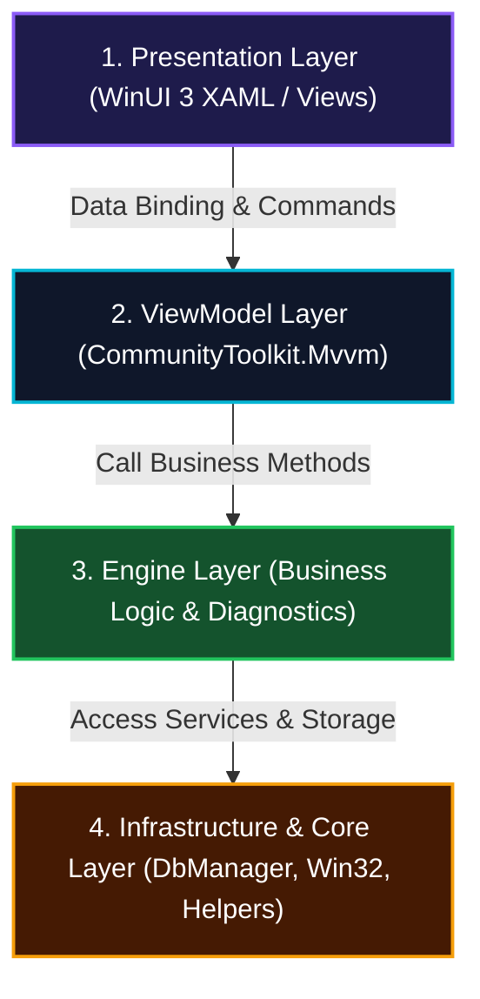

# 📐 01. Architecture & Design Rules

> [🏠 Rules Index](README.md) • **Rule 01** • [Next Rule: 02. Security & Safety ➡️](02_SECURITY_AND_SAFETY_RULES.md)

---

## 🏛️ 1. Strict 4-Tier Architecture

WinCare Pro enforces an isolated 4-tier modular architecture. The dependency direction MUST flow strictly unidirectional from exterior to core:

$$\text{Presentation (UI/Views)} \longrightarrow \text{ViewModel} \longrightarrow \text{Engines (Business Logic)} \longrightarrow \text{Infrastructure / Core}$$



### Inviolable Architectural Invariants:
- ❌ **FORBIDDEN:** Presentation layer invoking Engine or Infrastructure methods directly, bypassing ViewModel.
- ❌ **FORBIDDEN:** Engine layer referencing any XAML UI controls (`Button`, `TextBox`, `SolidColorBrush`, `Window`).
- ❌ **FORBIDDEN:** Tight coupling or direct references between ViewModels. Cross-ViewModel communication MUST use `WeakReferenceMessenger` or shared mediator services.

---

## 🧩 2. Modular MVVM Pattern Standards

Each functional feature inside `Modules/` MUST exist as an autonomous **View - ViewModel** pair:

```
Modules/
└── JunkCleaner/
    ├── JunkCleanerPage.xaml       # UI structure and layout declaration
    ├── JunkCleanerPage.xaml.cs    # Code-behind (strictly limited to animations & Win32 window hooks)
    └── JunkViewModel.cs           # State, commands, and binding properties
```

### ViewModel Standards:
1. **Inherit from `ViewModelBase`:** All ViewModels MUST inherit from `ViewModelBase` to utilize thread-safe `RunOnUI()` dispatching and `IsBusy` lifecycle management.
2. **Utilize Source Generators:** MUST use `[ObservableProperty]` and `[RelayCommand]` attributes from `CommunityToolkit.Mvvm` instead of manual `INotifyPropertyChanged` boilerplate.
3. **Lazy Initialization:** NEVER execute heavy disk I/O or system scanning inside constructors. Data initialization MUST be triggered asynchronously during the View's `Loaded` event or via user-initiated commands.

---

## 💉 3. Dependency Injection (DI) & Lifetime Governance

The DI container is configured in [App.xaml.cs](../../App.xaml.cs) using `Microsoft.Extensions.DependencyInjection`:

| Lifetime | Target Scope | Example Classes |
| :--- | :--- | :--- |
| **Singleton** | System services, database managers, caches, UI coordinators | `DbManager`, `ThemeManager`, `TranslationManager`, `NotificationService`, `LockingAppService` |
| **Transient** | Stateless calculation engines, page-specific ViewModels | `JunkCleanerEngine`, `SystemOptimizerEngine`, `JunkViewModel`, `DashboardViewModel` |

### Dependency Injection Rules:
- ✅ **Constructor Injection:** ALWAYS inject dependencies through constructors.
- ❌ **FORBIDDEN Service Locator Anti-Pattern:** NEVER call `App.Services.GetService<T>()` directly inside Engine business logic; restrict usage strictly to application bootstrapper routines.

---

## 🪟 4. Application Lifecycle Standards (Single-Instance & Background Minimization)

1. **Single-Instance Enforcement:**
   - The primary application MUST enforce a single instance using a named global mutex: `Local\WinCarePro_SingleInstance_Mutex`.
   - When a secondary instance is detected, the existing application window MUST be activated to the foreground via `SetForegroundWindow`, and the duplicate process MUST terminate immediately.
2. **Desktop HUD Widget Isolation:**
   - The Desktop HUD Widget is an independent `Window` that shares the existing Data Context or Singleton Engine.
   - When the main window is closed, if background execution is enabled, the application MUST minimize to the Windows System Tray rather than invoking `Environment.Exit(0)`.

---

<div align="center">
  <sub>[🏠 Rules Index](README.md) • WinCare Pro Suite Production Engineering Governance</sub>
</div>
