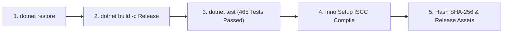

# 📦 08. Release Packaging & CI/CD Rules

> [⬅️ 07. Testing & QA](07_TESTING_AND_QA_RULES.md) • [🏠 Rules Index](README.md) • **Rule 08** • [Next Rule: 09. Registry & OS Interop ➡️](09_REGISTRY_AND_OS_INTEROP_RULES.md)

---

## 🚀 1. Production Publishing Specifications (Self-Contained Publish)

1. **Target Architecture:** `win-x64` (strictly supported and verified).
2. **Self-Contained Deployment:**
   - Production releases **MUST** specify `--self-contained true` to embed the complete .NET 10 Runtime, guaranteeing standalone execution without external framework dependencies.
3. **Canonical Compilation Invocation:**
   ```powershell
   dotnet publish WinCarePro.csproj `
       -c Release `
       -r win-x64 `
       --self-contained true `
       -p:PublishSingleFile=false `
       -p:IncludeNativeLibrariesForSelfExtract=true `
       -p:EnableCompressionInSingleFile=true `
       -o "./PublishOutputFolder"
   ```

---

## 📦 2. Inno Setup Packaging Standards (`setup.iss`)

1. **Elevation & Privileges:**
   - Mandatory directives: `PrivilegesRequired=admin` and `PrivilegesRequiredOverridesAllowed=no`.
2. **Process Detection & Mutex Coordination:**
   - The installer MUST check the WinCare Pro and Desktop Widget mutex handles, prompting the user or gracefully terminating active processes before overwriting locked binaries.
3. **Deterministic Uninstallation:**
   - The uninstaller MUST cleanly purge all application binaries under `Program Files\WinCarePro\`.
   - The uninstaller MUST provide an explicit prompt offering to retain or purge user configuration data in `%LocalAppData%\WinCarePro\`.

---

## 🏷️ 3. Semantic Versioning Governance (SemVer 2.0)

Version strings strictly follow **`MAJOR.MINOR.PATCH`** (e.g. `5.0.0`):

- **MAJOR:** Architectural rewrites or breaking UI paradigm shifts.
- **MINOR:** New functional modules or major engine enhancements.
- **PATCH:** Bug fixes, performance optimizations, definitions updates, or security patches.

### Synchronized Single Source of Truth (SSOT):
Version bumps MUST be updated atomically across:
1. `Core/AppConstants.cs` (`DefaultVersionString`, `DefaultAssemblyVersionString`)
2. `WinCarePro.csproj` (`<Version>`, `<AssemblyVersion>`, `<FileVersion>`, `<InformationalVersion>`, `<Product>`)
3. `setup.iss` (`#define MyAppVersion "5.0.0"`)
4. `update.json` (`"version"`, `"url"`, `"changelog"`)
5. `Package.appxmanifest` (`Version="5.0.0.0"`)
6. `MainWindow.xaml` and `SettingsPage.xaml` (Version badges & hero labels)
7. `TranslationManager.Translations.cs` (Matching translation keys)

---

## 🤖 4. Continuous Integration & Deployment (GitHub Actions CI/CD)

All pull requests and commits to `main` MUST pass all steps defined in `.github/workflows/ci.yml`:



---

<div align="center">
  <sub>[🏠 Rules Index](README.md) • WinCare Pro Suite Production Engineering Governance</sub>
</div>

