# 🛡️ WinCare Pro Suite — Production System Rules & Engineering Governance

> **Target Release:** v5.0.0 Polaris (Production Release)  
> **Target Platform:** Windows 10 (Build 19041+) & Windows 11 (x64)  
> **Core Stack:** .NET 10.0 • C# 13 • Windows App SDK (WinUI 3) • SQLite WAL  
> **Primary Mandate:** Guarantee deterministic stability, zero data loss, high performance, and enterprise-grade code hygiene.

---

## 🏛️ 1. Core Hierarchy of Priorities

All technical architecture decisions, source modifications, and feature deployments across WinCare Pro **MUST** strictly obey the inviolable hierarchy:

$$\mathbf{Safety} > \mathbf{Correctness} > \mathbf{Security} > \mathbf{Stability} > \mathbf{Performance} > \mathbf{Maintainability} > \mathbf{UX} > \mathbf{Aesthetics}$$

1. **Safety:** NEVER corrupt operating system files, delete user data, or terminate essential Windows services.
2. **Correctness:** Telemetry, scanned capacities, hardware metrics, and OS operations MUST reflect authentic state; synthetic mocking in production is STRICTLY FORBIDDEN.
3. **Security:** Zero-Trust posture. Eliminate command injection, path traversal, and credential leakage.
4. **Stability:** Zero-crash runtime. Marshal 100% of UI mutations to the UI thread, handle Win32/IO faults gracefully, and support cooperative task cancellation.
5. **Performance:** Sub-15MB tray RAM, cold start under 350ms, smooth 120 FPS UI dispatching.

---

## 🗺️ 2. Rules Architecture Map

```mermaid
graph TD
    classDef index fill:#1e1b4b,stroke:#8b5cf6,stroke-width:2px,color:#fff;
    classDef arch fill:#0f172a,stroke:#06b6d4,stroke-width:2px,color:#fff;
    classDef sec fill:#451a03,stroke:#f59e0b,stroke-width:2px,color:#fff;
    classDef thread fill:#14532d,stroke:#22c55e,stroke-width:2px,color:#fff;
    classDef perf fill:#701a75,stroke:#ec4899,stroke-width:2px,color:#fff;
    classDef code fill:#1e3a8a,stroke:#3b82f6,stroke-width:2px,color:#fff;

    Index["📋 README.md (Production Rules Master Index)"]:::index

    R01["01. Architecture & Design<br/>(01_ARCHITECTURE_AND_DESIGN_RULES.md)"]:::arch
    R02["02. Security & Safety<br/>(02_SECURITY_AND_SAFETY_RULES.md)"]:::sec
    R03["03. Concurrency & Threading<br/>(03_CONCURRENCY_AND_THREADING_RULES.md)"]:::thread
    R04["04. Performance & Memory<br/>(04_PERFORMANCE_AND_MEMORY_RULES.md)"]:::perf
    R05["05. C# 13 Coding Standards<br/>(05_CODING_STANDARDS_AND_CONVENTIONS.md)"]:::code
    R06["06. UI/UX & Aesthetics<br/>(06_UI_UX_AND_AESTHETICS_RULES.md)"]:::code
    R07["07. Testing & QA<br/>(07_TESTING_AND_QA_RULES.md)"]:::sec
    R08["08. Packaging & CI/CD<br/>(08_RELEASE_PACKAGING_AND_CICD_RULES.md)"]:::arch
    R09["09. Registry & OS Interop<br/>(09_REGISTRY_AND_OS_INTEROP_RULES.md)"]:::sec
    R10["10. Incident Logging & Privacy<br/>(10_INCIDENT_MANAGEMENT_AND_LOGGING_RULES.md)"]:::thread
    R11["11. AI Agent Efficiency & Precision<br/>(11_AI_AGENT_EFFICIENCY_AND_PRECISION_RULES.md)"]:::code

    Index --> R01
    Index --> R02
    Index --> R03
    Index --> R04
    Index --> R05
    Index --> R06
    Index --> R07
    Index --> R08
    Index --> R09
    Index --> R10
    Index --> R11
```

---

## 📑 3. Technical Rulebooks Directory

| No. | Rulebook Identifier | Core Scope & Architectural Mandate | Enforcement Level |
| :---: | :--- | :--- | :---: |
| **01** | [**01. Architecture & Design**](01_ARCHITECTURE_AND_DESIGN_RULES.md) | 4-tier layer isolation, modular MVVM, DI lifetimes, single-instance lifecycle, dependency leak prevention. | 🔴 **Mandatory (100%)** |
| **02** | [**02. Security & System Safety**](02_SECURITY_AND_SAFETY_RULES.md) | Command injection prevention (`ArgumentList`), SafePathGuard, SafeRegistryGuard, protected service whitelist, WinTrust, DPAPI. | 🔴 **Mandatory (100%)** |
| **03** | [**03. Concurrency & Threading**](03_CONCURRENCY_AND_THREADING_RULES.md) | UI thread marshaling (`RunOnUI`), `CancellationToken` propagation, SQLite WAL serialization, deadlock elimination. | 🔴 **Mandatory (100%)** |
| **04** | [**04. Performance & Memory Management**](04_PERFORMANCE_AND_MEMORY_RULES.md) | Sub-15MB tray RAM compaction, cold start < 350ms, event leak prevention, Tabular figures, I/O caching. | 🟡 **Strict** |
| **05** | [**05. C# 13 & .NET 10 Coding Standards**](05_CODING_STANDARDS_AND_CONVENTIONS.md) | `OperationResult<T>` pattern, Nullable reference safety, Zero-Silent Catch policy, naming conventions, dual-language i18n. | 🔴 **Mandatory (100%)** |
| **06** | [**06. Aura Glass UI/UX & Aesthetics**](06_UI_UX_AND_AESTHETICS_RULES.md) | Mica/Acrylic backdrops, 120 FPS composition, shimmer loaders, WCAG AAA contrast, Theme Studio palette tokens. | 🟡 **Strict** |
| **07** | [**07. Testing & Quality Assurance**](07_TESTING_AND_QA_RULES.md) | 100% test pass rate (465/465 Tests), in-memory SQLite sandboxing, Win32 mocks, stress & edge-case matrices. | 🔴 **Mandatory (100%)** |
| **08** | [**08. Release Packaging & CI/CD**](08_RELEASE_PACKAGING_AND_CICD_RULES.md) | Self-Contained x64 distribution, Inno Setup mutex coordination, SemVer 2.0 versioning, GitHub Actions automation. | 🔴 **Mandatory (100%)** |
| **09** | [**09. Registry & OS Native Interop**](09_REGISTRY_AND_OS_INTEROP_RULES.md) | SafeRegistryGuard depth checks, root hive protection, mandatory pre-mutation `.reg` backups, `SafeHandle` discipline. | 🔴 **Mandatory (100%)** |
| **10** | [**10. Incident Management & Logging**](10_INCIDENT_MANAGEMENT_AND_LOGGING_RULES.md) | Audit Log vs Crash Logger segregation, Zero-PII sanitization, 5MB log rotation (30-day retention), global crash hooks. | 🔴 **Mandatory (100%)** |
| **11** | [**11. AI Agent Efficiency & Precision**](11_AI_AGENT_EFFICIENCY_AND_PRECISION_RULES.md) | Prompt/output token economy, targeted slicing (30-60 lines), minimal-anchor patching, log suppression, API verification. | 🔴 **Mandatory (100%)** |

---

## 🚦 4. Code Review & Merge Gate Requirements

Before any Pull Request or change set is merged into `main`:

1. **Static Analysis:** Zero compiler errors and zero new compiler warnings (`0 Errors, 0 Warnings`).
2. **Automated Test Suite:** 100% passing rate across all 465 xUnit test cases in `WinCarePro.Tests`.
3. **Security Audit:** Zero raw CLI string concatenation and verified argument isolation.
4. **Safety Check:** All filesystem deletions and registry modifications guarded by `SafePathGuard` & `SafeRegistryGuard` with snapshot/undo support.

---

  Maintained by <b>WinCare Pro Core Architecture & Engineering Team</b>

