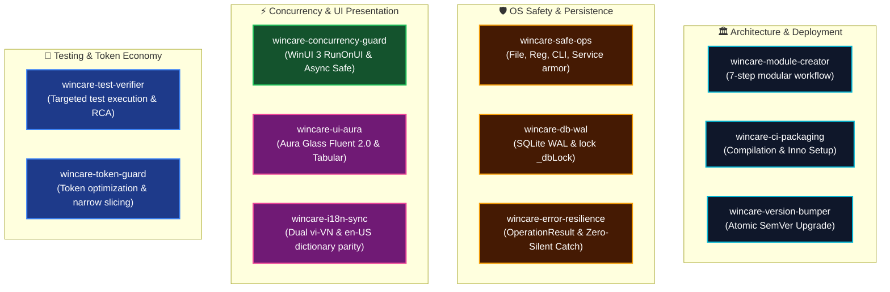

# 🧠 WinCare Pro — AI Agent Technical Skills Directory

> **Target Release:** v5.1.1 (Codename: Polaris) | **Target Platform:** Windows 10/11 x64  
> **Standard:** Google Antigravity Skills Specification (`SKILL.md`, `scripts/`, `examples/`, `resources/`)  
> **Mandate:** Provide domain-specific, actionable operational runbooks and modular assets enabling AI Agents to code with 100% precision, zero hallucination, zero crashes, and strict architectural compliance.

---

## 🏛️ Standard Antigravity Skill Directory Structure

Every skill in WinCare Pro strictly adheres to the official Google Antigravity Skill architecture:

```text
skills/<skill-name>/
├── SKILL.md       # Required: Main instruction runbook with YAML frontmatter (name, description)
├── scripts/       # Automation & verification scripts (.ps1)
├── examples/      # Canonical production-grade reference implementations (.cs, .xaml)
└── resources/     # Templates, schemas, checklists, and reference catalogs (.cs, .xaml, .json, .md)
```

---

## 🗺️ Core Skills Architecture Matrix



---

## 📋 Standardized Technical Skills Directory

| No. | Skill Name | Included Assets & Helpers | Core Operational Scope |
| :---: | :--- | :--- | :--- |
| **01** | [`wincare-module-creator`](wincare-module-creator/SKILL.md) | `scripts/scaffold-module.ps1`<br/>`examples/SampleCleanerEngine.cs`<br/>`resources/*Templates*` | 7-step modular lifecycle (`Model` $\rightarrow$ `Engine` $\rightarrow$ `DI` $\rightarrow$ `ViewModel` $\rightarrow$ `Aura View` $\rightarrow$ `i18n` $\rightarrow$ `xUnit`). |
| **02** | [`wincare-safe-ops`](wincare-safe-ops/SKILL.md) | `scripts/audit-safety-guards.ps1`<br/>`examples/Safe*.cs`<br/>`resources/protected-services-reference.json` | Safe OS operations: `SafePathGuard`, `SafeRegistryGuard`, `.reg` backup, `ProcessRunner` (`ArgumentList`), service protection, DPAPI. |
| **03** | [`wincare-concurrency-guard`](wincare-concurrency-guard/SKILL.md) | `scripts/scan-concurrency-issues.ps1`<br/>`examples/RunOnUi*.cs`<br/>`resources/concurrency-best-practices.md` | WinUI 3 threading: `RunOnUI()` dispatching, `DispatcherQueue`, `[RelayCommand(IncludeCancelCommand = true)]`, `CancellationToken` lifecycle. |
| **04** | [`wincare-ui-aura`](wincare-ui-aura/SKILL.md) | `scripts/verify-ui-conventions.ps1`<br/>`examples/SampleAuraPage.*`<br/>`resources/AuraGlassResourceDictionary.xaml` | Aura Glass (Fluent 2.0): 8px corner radii, Tabular numerals, unhooking `Unloaded` events, `TranslationConverter`. |
| **05** | [`wincare-i18n-sync`](wincare-i18n-sync/SKILL.md) | `scripts/verify-i18n-parity.ps1`<br/>`examples/Translation*.cs/.xaml`<br/>`resources/i18n-taxonomy.md` | Dual-language dictionary parity across `vi-VN` and `en-US` in `TranslationManager.Translations.cs`, zero hardcoded text. |
| **06** | [`wincare-db-wal`](wincare-db-wal/SKILL.md) | `scripts/verify-db-wal-schema.ps1`<br/>`examples/DbManager*.cs`<br/>`resources/sqlite-wal-configuration.md` | SQLite 3 WAL persistence: serialize queries via `lock (_dbLock)`, parameterized queries, `DatabaseTestCollection` fixtures. |
| **07** | [`wincare-error-resilience`](wincare-error-resilience/SKILL.md) | `scripts/scan-silent-catch.ps1`<br/>`examples/OperationResult*.cs`<br/>`resources/error-handling-matrix.md` | Comprehensive resilience: `OperationResult<T>` pattern, Zero-Silent Catch elimination, `CrashLogger.LogError` tracking. |
| **08** | [`wincare-test-verifier`](wincare-test-verifier/SKILL.md) | `scripts/run-targeted-tests.ps1`<br/>`examples/StandardEngineTests.cs`<br/>`resources/test-failure-rca-guide.md` | Token-efficient xUnit testing: filtered execution (`--filter`), `DatabaseTestCollection` management, root cause analysis. |
| **09** | [`wincare-token-guard`](wincare-token-guard/SKILL.md) | `scripts/token-slice-helper.ps1`<br/>`examples/MinimalDiffAnchorsExample.md`<br/>`resources/token-economy-rules.md` | Token and context optimization: targeted `grep_search`, narrow 30-60 line slicing, minimal-anchor diff patching. |
| **10** | [`wincare-ci-packaging`](wincare-ci-packaging/SKILL.md) | `scripts/verify-build-quiet.ps1`<br/>`examples/AppConstantsVersionExample.cs`<br/>`resources/release-smoke-test-checklist.md` | Packaging and release engineering: quiet compilation checks, Self-Contained x64 .NET 10 deployment, Inno Setup installer. |
| **11** | [`wincare-version-bumper`](wincare-version-bumper/SKILL.md) | `scripts/bump-version.ps1`<br/>`scripts/verify-version-sync.ps1`<br/>`examples/AppVersionSyncExample.cs`<br/>`resources/version-synchronization-matrix.md` | Software version upgrade & release management: atomic SemVer synchronization across AppConstants, manifests, installer, update feed & xUnit tests. |

---

## ⚡ Agent Operational Execution Workflow

1. **Pre-Implementation Assessment:**
   - Classify technical scope and consult the corresponding skill runbook (e.g., creating a module $\rightarrow$ consult `wincare-module-creator`).
   - Lookup canonical signatures in `docs/00_AI_SYMBOL_INDEX.md` for $O(1)$ symbol access.
2. **During Implementation:**
   - Operating system layer $\rightarrow$ Adhere to `wincare-safe-ops`.
   - Threading / WinUI 3 $\rightarrow$ Adhere to `wincare-concurrency-guard`.
   - UI Display strings $\rightarrow$ Adhere to `wincare-i18n-sync`.
   - SQLite persistence $\rightarrow$ Adhere to `wincare-db-wal`.
   - Exception handling $\rightarrow$ Adhere to `wincare-error-resilience`.
3. **Pre-Handoff Verification:**
   - Validate regression tests via `wincare-test-verifier`.
   - Verify all pre-handoff quality checklist criteria in [AGENTS.md](../../AGENTS.md).
