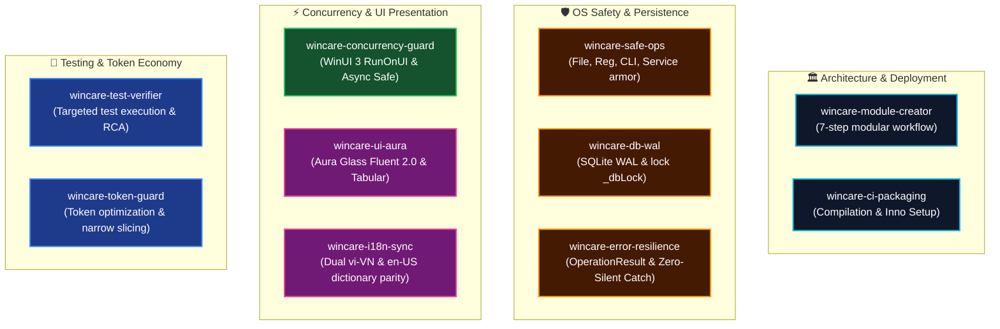

# 🧠 WinCare Pro — AI Agent Technical Skills Directory

> **Target Release:** v5.0.0 (Codename: Polaris) | **Target Platform:** Windows 10/11 x64  
> **Mandate:** Provide domain-specific, actionable operational runbooks enabling AI Agents to code with 100% precision, zero hallucination, zero crashes, and strict architectural compliance.

---

## 🗺️ Core Skills Architecture Matrix

---

## 📋 Technical Playbooks Directory

| No. | Skill Name | Core Operational Scope | Activation Trigger |
| :---: | :--- | :--- | :--- |
| **01** | [`wincare-module-creator`](wincare-module-creator/SKILL.md) | Standardized 7-step modular implementation (`Model` $\rightarrow$ `Engine` $\rightarrow$ `DI` $\rightarrow$ `ViewModel` $\rightarrow$ `Aura View` $\rightarrow$ `i18n` $\rightarrow$ `xUnit`). | Adding new pages, features, or modules to WinCare Pro. |
| **02** | [`wincare-safe-ops`](wincare-safe-ops/SKILL.md) | Safe OS operations: `SafePathGuard`, `SafeRegistryGuard`, pre-mutation `.reg` backup, `ProcessRunner` with `ArgumentList`, 45+ service armor, DPAPI encryption. | Manipulating files, Registry keys, spawning processes, or altering Windows services. |
| **03** | [`wincare-concurrency-guard`](wincare-concurrency-guard/SKILL.md) | WinUI 3 threading: `RunOnUI()` dispatching, `DispatcherQueue`, `[RelayCommand(IncludeCancelCommand = true)]`, `CancellationToken` lifecycle, sync-over-async elimination. | Authoring asynchronous methods, worker tasks, timers, or UI data bindings. |
| **04** | [`wincare-ui-aura`](wincare-ui-aura/SKILL.md) | Aura Glass (Fluent 2.0) interface styling: 8px corner radii, Tabular numerals, unhooking `Unloaded` events, `TranslationConverter` binding. | Creating or updating XAML views, styles, or visual layouts. |
| **05** | [`wincare-i18n-sync`](wincare-i18n-sync/SKILL.md) | Dual-language dictionary parity across `vi-VN` and `en-US` in `TranslationManager.Translations.cs`, standardized `Mod_{Module}_{Key}` keys, zero hardcoded text. | Adding or editing UI labels, dialogs, button texts, tooltips, or placeholders. |
| **06** | [`wincare-db-wal`](wincare-db-wal/SKILL.md) | SQLite 3 WAL persistence: serialize queries via `lock (_dbLock)`, prevent lock contention, parameterize SQL queries, database test fixtures. | Interacting with `DbManager`, persisting settings, audit logs, or cleaning history. |
| **07** | [`wincare-error-resilience`](wincare-error-resilience/SKILL.md) | Comprehensive resilience: `OperationResult<T>` return pattern, Zero-Silent Catch elimination, `CrashLogger.LogError` tracking, graceful fallbacks. | Designing method signatures, catching Win32/WMI faults, or reporting user errors. |
| **08** | [`wincare-test-verifier`](wincare-test-verifier/SKILL.md) | Token-efficient xUnit testing: filtered execution (`--filter`), `DatabaseTestCollection` fixture management, root cause analysis, target 100% Passed. | Validating bug fixes, diagnosing regression test failures, or preparing commits. |
| **09** | [`wincare-token-guard`](wincare-token-guard/SKILL.md) | Token and context optimization: targeted `grep_search`, narrow 30-60 line `view_file` slicing, minimal-anchor diff patching, zero whole-file rewrites. | Analyzing or editing source files across the codebase. |
| **10** | [`wincare-ci-packaging`](wincare-ci-packaging/SKILL.md) | Packaging and release engineering: quiet compilation checks, Self-Contained x64 .NET 10 deployment via `publish.bat`, Inno Setup installer via `publish_installer.bat`. | Verifying syntax, compiling binaries, building installers, or tagging releases. |

---

## ⚡ Agent Operational Execution Workflow

1. **Pre-Implementation Assessment:**
   - Classify technical scope and consult the corresponding skill runbook (e.g., creating a module $\rightarrow$ consult `wincare-module-creator`).
   - Lookup canonical signatures in `docs/00_AI_SYMBOL_INDEX.md` for $O(1)$ symbol access.
2. **During Implementation:**
   - Operating system layer $\rightarrow$ Adhere to `wincare-safe-ops`.
   - Threading / WinUI 3 $\rightarrow$ Adhere to `wincare-concurrency-guard`.
   - UI Display strings $\rightarrow$ Adhere to `wincare-i18n-sync`.
   - SQLite persistence $\rightarrow$ Adhere to `wincare-db-wal`.
   - Exception handling $\rightarrow$ Adhere to `wincare-error-resilience`.
3. **Pre-Handoff Verification:**
   - Validate regression tests via `wincare-test-verifier`.
   - Verify all pre-handoff quality checklist criteria in [AGENTS.md](../../AGENTS.md).
