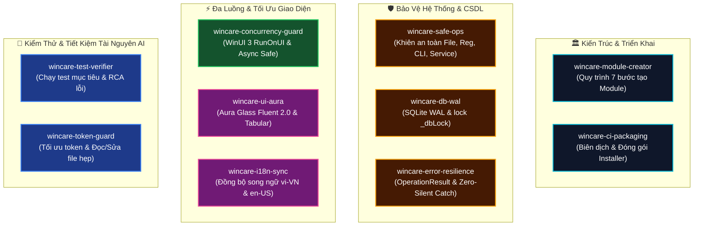

# 🧠 WinCare Pro — Bộ Kỹ Năng Kỹ Thuật Toàn Diện Cho AI (AI Agent Skills Index)
> **Phiên bản:** v5.0.0 (Codename: Polaris) | **Nền tảng:** Windows 10/11 x64  
> **Mục tiêu:** Cung cấp hướng dẫn tác vụ chuyên sâu, cụ thể theo từng lĩnh vực kỹ thuật giúp AI Agent lập trình chính xác $100\%$, không ảo giác, không gây crash và tuân thủ tuyệt đối quy chuẩn kiến trúc của dự án.

---

## 🗺️ Bản Đồ 10 Kỹ Năng Kỹ Thuật Cốt Lõi (Skills Matrix)

---

## 📋 Danh Mục Tra Cứu Chi Tiết 10 Kỹ Năng

| STT | Kỹ năng (Skill) | Mục đích sử dụng | Khi nào kích hoạt? |
| :---: | :--- | :--- | :--- |
| **01** | [`wincare-module-creator`](file:///d:/WinCare/.agents/skills/wincare-module-creator/SKILL.md) | Triển khai phân hệ mới theo mô hình 4 tầng phân lập chuẩn (Model $\rightarrow$ Engine $\rightarrow$ DI $\rightarrow$ ViewModel $\rightarrow$ Aura View $\rightarrow$ i18n $\rightarrow$ xUnit). | Khi thêm trang, tính năng hoặc phân hệ mới vào WinCare Pro. |
| **02** | [`wincare-safe-ops`](file:///d:/WinCare/.agents/skills/wincare-safe-ops/SKILL.md) | Thao tác OS an toàn: `SafePathGuard`, `SafeRegistryGuard`, sao lưu Registry trước khi xóa, `ProcessRunner` với `ArgumentList`, bảo vệ 45+ Windows Service, mã hóa DPAPI. | Khi viết mã chạm vào tệp tin, Registry, gọi lệnh Shell hoặc can thiệp Windows Services. |
| **03** | [`wincare-concurrency-guard`](file:///d:/WinCare/.agents/skills/wincare-concurrency-guard/SKILL.md) | Xử lý đa luồng WinUI 3: Điều hướng `RunOnUI()`, `DispatcherQueue`, `[RelayCommand(IncludeCancelCommand = true)]`, quản lý `CancellationToken`, triệt tiêu Sync-over-Async. | Khi viết phương thức async, tác vụ nền, timer hoặc cập nhật giao diện người dùng. |
| **04** | [`wincare-ui-aura`](file:///d:/WinCare/.agents/skills/wincare-ui-aura/SKILL.md) | Xây dựng giao diện Aura Glass (Fluent 2.0): Bo góc 8px, bảng số Tabular, gỡ bỏ sự kiện Unloaded chống rò rỉ RAM, tích hợp TranslationConverter. | Khi viết hoặc sửa đổi các tệp XAML, Style hoặc cấu trúc giao diện. |
| **05** | [`wincare-i18n-sync`](file:///d:/WinCare/.agents/skills/wincare-i18n-sync/SKILL.md) | Đồng bộ 100% từ điển song ngữ `vi-VN` và `en-US` trong `TranslationManager.Translations.cs`, chuẩn hóa taxonomy key `Mod_{Module}_{Key}`, chống hardcode chuỗi text. | Khi thêm nhãn, thông báo, nút bấm, tooltip hoặc placeholder trên giao diện. |
| **06** | [`wincare-db-wal`](file:///d:/WinCare/.agents/skills/wincare-db-wal/SKILL.md) | Quản trị CSDL SQLite 3 chế độ WAL: Bọc 100% truy vấn trong `lock (_dbLock)`, chống nghẽn luồng trong lock, chống SQL Injection bằng tham số, fixture test CSDL. | Khi tương tác với `DbManager`, lưu cấu hình, audit log hoặc lịch sử quét dọn. |
| **07** | [`wincare-error-resilience`](file:///d:/WinCare/.agents/skills/wincare-error-resilience/SKILL.md) | Xử lý lỗi toàn diện: Trả về `OperationResult<T>`, triệt tiêu khối `catch { }` rỗng (Zero-Silent Catch), ghi log lỗi qua `CrashLogger.LogError`, chiến lược phục hồi mềm dẻo. | Khi thiết kế chữ ký phương thức, bắt ngoại lệ hệ thống hoặc hiển thị cảnh báo lỗi. |
| **08** | [`wincare-test-verifier`](file:///d:/WinCare/.agents/skills/wincare-test-verifier/SKILL.md) | Quy trình chạy test xUnit tối ưu: Chạy test lọc theo lớp (`--filter`), xử lý va chạm CSDL qua `DatabaseTestCollection`, phân tích RCA khi test thất bại, mục tiêu 100% Passed. | Khi chạy kiểm thử, chẩn đoán lỗi hồi quy hoặc chuẩn bị commit mã nguồn. |
| **09** | [`wincare-token-guard`](file:///d:/WinCare/.agents/skills/wincare-token-guard/SKILL.md) | Tối ưu hóa Context Window & Token: Sử dụng `grep_search` định vị, đọc lát cắt hẹp 30-60 dòng qua `view_file`, sửa file qua diff anchor ngắn, cấm ghi đè file lớn. | Khi phân tích hoặc chỉnh sửa mã nguồn trên toàn bộ giải pháp. |
| **10** | [`wincare-ci-packaging`](file:///d:/WinCare/.agents/skills/wincare-ci-packaging/SKILL.md) | Quy trình đóng gói và phát hành: Biên dịch tối giản log, chạy `publish.bat` (Self-Contained x64 .NET 10), đóng gói Inno Setup `publish_installer.bat`, kiểm tra bản release. | Khi build kiểm tra cú pháp, xuất gói cài đặt hoặc chuẩn bị phát hành phiên bản mới. |

---

## ⚡ Hướng Dẫn Sử Dụng Nhanh Cho AI Agent

1. **Trước khi bắt đầu bất kỳ tác vụ nào:**
   - Đọc kỹ yêu cầu và xác định miền kỹ thuật liên quan (ví dụ: cần thêm module mới $\rightarrow$ tham chiếu `wincare-module-creator`).
   - Kiểm tra `docs/00_AI_SYMBOL_INDEX.md` để lấy chữ ký API chuẩn xác $O(1)$.
2. **Trong quá trình lập trình:**
   - Chạm vào hệ thống $\rightarrow$ Tuân thủ `wincare-safe-ops`.
   - Chạm vào đa luồng / UI $\rightarrow$ Tuân thủ `wincare-concurrency-guard`.
   - Chạm vào văn bản $\rightarrow$ Tuân thủ `wincare-i18n-sync`.
   - Chạm vào CSDL $\rightarrow$ Tuân thủ `wincare-db-wal`.
   - Bắt ngoại lệ $\rightarrow$ Tuân thủ `wincare-error-resilience`.
3. **Trước khi hoàn tất bàn giao:**
   - Chạy test kiểm chứng qua `wincare-test-verifier`.
   - Rà soát bảng Checklist trong [AGENTS.md](file:///d:/WinCare/AGENTS.md).
