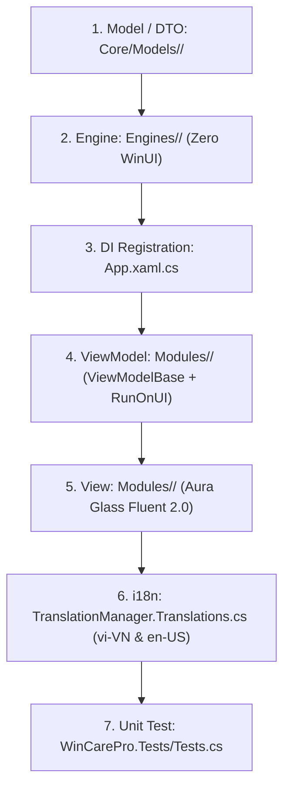

# 🚀 WinCare Pro — Quy Trình Xây Dựng Phân Hệ Chuẩn (Module Creator Workflow)

Quy chuẩn này bắt buộc áp dụng khi thêm mới hoặc mở rộng bất kỳ phân hệ nào trong WinCare Pro Suite. Mọi bước phải tuân thủ nghiêm ngặt mô hình 4 tầng phân lập.

---

## 📋 Quy Trình 7 Bước Triển Khai (7-Step SOP)



---

### Bước 1: Tạo DTO / Model
- Vị trí: `Core/Models/<Feature>/` hoặc `Core/Models/`
- Quy tắc:
  - Bắt buộc trả về kết quả qua `OperationResult` hoặc `OperationResult<T>`.
  - Khai báo kiểu dữ liệu rõ ràng, `record` hoặc `class`, hỗ trợ serialization nếu cần lưu SQLite.

### Bước 2: Xây Dựng Engine Nghiệp Vụ
- Vị trí: `Engines/<Category>/<Feature>Engine.cs`
- Quy tắc:
  - **CẤM** chứa bất kỳ WinUI type nào (`UIElement`, `Window`, `SolidColorBrush`,...).
  - Mọi phương thức async nặng **bắt buộc** nhận `CancellationToken ct = default`.
  - Kiểm tra `ct.ThrowIfCancellationRequested()`.
  - Tích hợp các Core Guards:
    - File I/O: `SafePathGuard.IsSafeToDelete(path)`
    - Registry: `SafeRegistryGuard.IsSafeToDeleteKey(key)` & `RegistryBackupEngine.BackupKey(...)`
    - CLI: `ProcessRunner.RunAsync(exe, args, ct)`
    - Services: `ServiceSafetyService.IsProtectedService(name)`
    - DPAPI: `CryptoHelper.Protect(secret)`
  - Template tham khảo: [EngineTemplate.cs](../../templates/EngineTemplate.cs)

### Bước 3: Đăng Ký Dependency Injection (DI)
- Vị trí: [App.xaml.cs](file:///d:/WinCare/App.xaml.cs)
- Quy tắc:
  - `services.AddTransient<<Feature>Engine>();`
  - `services.AddTransient<<Feature>ViewModel>();`
  - `services.AddTransient<<Feature>View>();` (nếu cần điều hướng qua NavigationService)

### Bước 4: Xây Dựng ViewModel
- Vị trí: `Modules/<Feature>/<Feature>ViewModel.cs`
- Kế thừa: `ViewModelBase`
- Quy tắc:
  - Bọc 100% cập nhật UI và `ObservableCollection` trong `RunOnUI(() => { ... })`.
  - Quản lý trạng thái:
    ```csharp
    try
    {
        IsBusy = true;
        StatusMessage = "DangXuLy...";
        // Gọi Engine...
    }
    catch (Exception ex)
    {
        CrashLogger.LogError(ex);
        StatusMessage = "Loi...";
    }
    finally
    {
        IsBusy = false;
        OperationState = OperationState.Idle;
    }
    ```
  - Giao tiếp chéo qua `WeakReferenceMessenger.Default.Send(...)`, tuyệt đối không giữ tham chiếu trực tiếp ViewModel khác.
  - Template tham khảo: [ViewModelTemplate.cs](../../templates/ViewModelTemplate.cs)

### Bước 5: Thiết Kế Giao Diện XAML (View)
- Vị trí: `Modules/<Feature>/<Feature>View.xaml`
- Quy tắc:
  - Sử dụng Aura Glass Fluent 2.0 (Mica backdrop, Card bo góc `CornerRadius="8"`).
  - Telemetry & con số bắt buộc dùng font tabular: `Typography.NumeralAlignment="Tabular"`.
  - Ràng buộc văn bản qua `TranslationConverter`:
    ```xml
    <TextBlock Text="{Binding Source='Nav_MyFeature', Converter={StaticResource TranslationConverter}}"/>
    ```
  - Unhook toàn bộ event (`-=`) khi `Unloaded` để tránh rò rỉ bộ nhớ.
  - Template tham khảo: [ViewTemplate.xaml](../../templates/ViewTemplate.xaml)

### Bước 6: Khai Báo Đa Ngôn Ngữ (i18n)
- Vị trí: [Services/TranslationService/TranslationManager.Translations.cs](file:///d:/WinCare/Services/TranslationService/TranslationManager.Translations.cs)
- Bắt buộc khai báo cả 2 từ điển `vi-VN` và `en-US`.
- Không bao giờ hardcode text tiếng Việt hoặc tiếng Anh trực tiếp trong XAML.

### Bước 7: Viết Unit Test & Kiểm Thử Hồi Quy
- Vị trí: `WinCarePro.Tests/<Feature>Tests.cs`
- Nếu test có thao tác `DbManager` (SQLite): Bắt buộc đánh dấu `[Collection(nameof(DatabaseTestCollection))]`.
- Chạy kiểm thử mục tiêu:
  ```powershell
  dotnet test WinCarePro.Tests/WinCarePro.Tests.csproj --filter "FullyQualifiedName~<Feature>Tests" --logger "console;verbosity=minimal"
  ```
