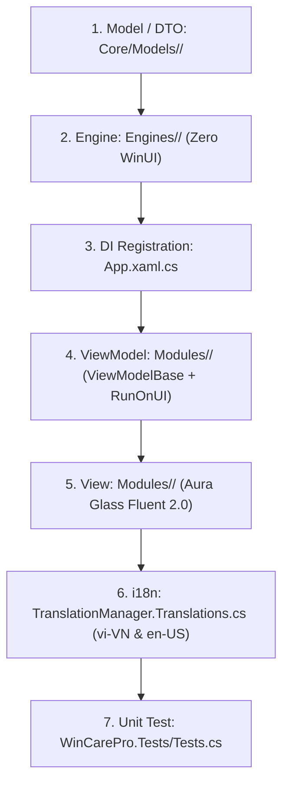

# 🚀 WinCare Pro — Standardized Module Development Lifecycle (Module Creator Workflow)

This standard governs the creation and extension of all modules across the WinCare Pro Suite. Every implementation step MUST strictly conform to the 4-tier decoupled architecture.

---

## 📋 7-Step Implementation Workflow (7-Step SOP)



---

### Step 1: Author DTOs & Domain Models
- Location: `Core/Models/<Feature>/` or `Core/Models/`
- Rules:
  - Methods MUST wrap results using `OperationResult` or `OperationResult<T>`.
  - Declare explicit types (`record` or `class`); ensure SQLite serialization compatibility if persisted.

### Step 2: Implement Business Logic Engine
- Location: `Engines/<Category>/<Feature>Engine.cs`
- Rules:
  - **STRICTLY FORBIDDEN** to reference any WinUI types (`UIElement`, `Window`, `SolidColorBrush`, etc.).
  - All resource-intensive asynchronous methods **MUST** accept `CancellationToken ct = default`.
  - Periodically verify cancellation via `ct.ThrowIfCancellationRequested()`.
  - Integrate native Core Guards:
    - File I/O: `SafePathGuard.IsSafeToDelete(path)`
    - Registry: `SafeRegistryGuard.IsSafeToDeleteKey(key)` & `RegistryBackupEngine.BackupKey(...)`
    - CLI Execution: `ProcessRunner.RunAsync(exe, args, ct)`
    - Windows Services: `ServiceSafetyService.IsProtectedService(name)`
    - DPAPI Encryption: `CryptoHelper.Protect(secret)`
  - Reference Template: [EngineTemplate.cs](../../templates/EngineTemplate.cs)

### Step 3: Register In Dependency Injection Container (DI)
- Location: [App.xaml.cs](../../App.xaml.cs)
- Rules:
  - Register transient engines: `services.AddTransient<<Feature>Engine>();`
  - Register transient view models: `services.AddTransient<<Feature>ViewModel>();`
  - Register transient views if navigated via NavigationService: `services.AddTransient<<Feature>View>();`

### Step 4: Implement ViewModel
- Location: `Modules/<Feature>/<Feature>ViewModel.cs`
- Base Class: `ViewModelBase`
- Rules:
  - Dispatch 100% of UI mutations and `ObservableCollection` updates through `RunOnUI(() => { ... })`.
  - Manage busy and error state rigorously:
    ```csharp
    try
    {
        IsBusy = true;
        StatusMessage = "Processing...";
        // Call Engine method...
    }
    catch (Exception ex)
    {
        CrashLogger.LogError(ex);
        StatusMessage = "Operation failed...";
    }
    finally
    {
        IsBusy = false;
        OperationState = OperationState.Idle;
    }
    ```
  - Cross-module communication MUST route through `WeakReferenceMessenger.Default.Send(...)`. Direct references to external ViewModels are STRICTLY FORBIDDEN.
  - Reference Template: [ViewModelTemplate.cs](../../templates/ViewModelTemplate.cs)

### Step 5: Construct Fluent 2.0 XAML View
- Location: `Modules/<Feature>/<Feature>View.xaml`
- Rules:
  - Apply Fluent 2.0 Aura Glass styling (Mica backdrop, Card border radius `CornerRadius="8"`).
  - Telemetry and numerical metrics MUST use tabular font alignment: `Typography.NumeralAlignment="Tabular"`.
  - Bind display text via `TranslationConverter`:
    ```xml
    <TextBlock Text="{Binding Source='Nav_MyFeature', Converter={StaticResource TranslationConverter}}"/>
    ```
  - Detach all event handlers (`-=`) in the `Unloaded` event to prevent memory leaks.
  - Reference Template: [ViewTemplate.xaml](../../templates/ViewTemplate.xaml)

### Step 6: Register Dual-Language Keys (i18n)
- Location: [TranslationManager.Translations.cs](../../Services/TranslationService/TranslationManager.Translations.cs)
- Simultaneously register matching keys across both `vi-VN` and `en-US` dictionaries.
- Hardcoded Vietnamese or English string literals in XAML are STRICTLY FORBIDDEN.

### Step 7: Author Unit Tests & Regression Verification
- Location: `WinCarePro.Tests/<Feature>Tests.cs`
- If test suite interacts with `DbManager` (SQLite): MUST apply the `[Collection(nameof(DatabaseTestCollection))]` attribute.
- Execute targeted test suite:
  ```powershell
  dotnet test WinCarePro.Tests/WinCarePro.Tests.csproj --filter "FullyQualifiedName~<Feature>Tests" --logger "console;verbosity=minimal"
  ```
