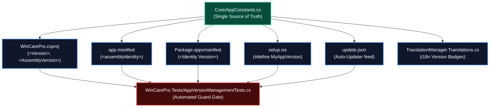

# 🔢 WinCare Pro — Software Version Bumping & Release Lifecycle (Version Bumper)

WinCare Pro mandates strict version synchronization across the desktop application, MSIX package manifests, Inno Setup installer scripts, automated update JSON feeds, and regression unit tests. 

Desynchronized version numbers trigger immediate xUnit test failures in `AppVersionManagementTests` and corrupt update checks.

## 📁 Skill Assets & Helpers
- **Automation Scripts:**
  - Automated Bumper: [`scripts/bump-version.ps1`](./scripts/bump-version.ps1)
  - Synchronicity Verifier: [`scripts/verify-version-sync.ps1`](./scripts/verify-version-sync.ps1)
- **Reference Examples:**
  - Dynamic SSOT Consumption: [`examples/AppVersionSyncExample.cs`](./examples/AppVersionSyncExample.cs)
- **Catalogs & Standards:**
  - 11 Touchpoints Matrix: [`resources/version-synchronization-matrix.md`](./resources/version-synchronization-matrix.md)
  - SemVer & Codename Rules: [`resources/semver-guidelines.md`](./resources/semver-guidelines.md)

---

## 🗺️ Version Synchronization Architecture



---

## 🚀 1. Automated Version Upgrade Workflow

To upgrade the version cleanly and atomically without human error, execute:

```powershell
# Preview changes (Dry Run):
powershell -ExecutionPolicy Bypass -File .agents/skills/wincare-version-bumper/scripts/bump-version.ps1 -NewVersion "5.1.2" -DryRun

# Execute atomic version bump:
powershell -ExecutionPolicy Bypass -File .agents/skills/wincare-version-bumper/scripts/bump-version.ps1 -NewVersion "5.1.2"
```

The script automatically updates:
1. `Core/AppConstants.cs` (`DefaultVersionString`, `DefaultAssemblyVersionString`, `DefaultBuildDate`, `new Version(...)`)
2. `WinCarePro.csproj` (`<Version>`, `<AssemblyVersion>`, `<FileVersion>`, `<InformationalVersion>`, `<Product>`)
3. `app.manifest` (`<assemblyIdentity version="..."/>`)
4. `Package.appxmanifest` (`<Identity Version="..."/>`)
5. `setup.iss` (`#define MyAppVersion "..."`)
6. `update.json` (`"version"`, download URL)
7. `WinCarePro.Tests/AppVersionManagementTests.cs` (Synchronizes all assertions)

---

## 🔍 2. Manual Verification Gate

After bumping the version:

1. **Verify All Touchpoints:**
   ```powershell
   powershell -ExecutionPolicy Bypass -File .agents/skills/wincare-version-bumper/scripts/verify-version-sync.ps1
   ```
2. **Execute Unit Tests:**
   ```powershell
   dotnet test WinCarePro.Tests/WinCarePro.Tests.csproj --filter "FullyQualifiedName~AppVersionManagementTests" --logger "console;verbosity=minimal"
   ```
3. **Update Release Documentation:**
   - Add new version header and highlights to [CHANGELOG.md](../../CHANGELOG.md).
   - Author [RELEASE_NOTES.md](../../RELEASE_NOTES.md).
   - Update header badges in [AGENTS.md](../../AGENTS.md) and [README.md](../../README.md).

