# 📐 01. System Architecture

> [🏠 Documentation Index](README.md) • **Chapter 01** • [Next: 02. Detailed Core Modules ➡️](02_CORE_MODULES_DETAILED.md)

This document provides a comprehensive technical overview of software architecture, design principles, data flow mechanisms, and Dependency Injection across the **WinCare Pro Suite v5.0 (Codename: Polaris)**.

---

## 1. Core Architectural Principles

WinCare Pro is built upon a non-negotiable quality hierarchy:

$$\mathbf{Safety} > \mathbf{Correctness} > \mathbf{Security} > \mathbf{Stability} > \mathbf{Performance} > \mathbf{Maintainability} > \mathbf{UX} > \mathbf{Aesthetics}$$

1. **Zero-Crash UI:** All resource-intensive routines (I/O, directory traversal, process inspection, system API calls) execute exclusively on background worker threads (`Task.Run`) with native `CancellationToken` support, dispatching UI mutations via `DispatcherQueue.TryEnqueue`.
2. **Fail-Safe by Default:** Every operating system modification (registry mutation, file purge, service configuration) MUST pass strict guard verification (`SafePathGuard`, `SafeRegistryGuard`, `ServiceSafetyService`), pre-mutation snapshots (`RegistryBackupEngine`, `SystemSnapshotService`), and return standardized `OperationResult<T>` records.
3. **Modular MVVM:** Presentation views and ViewModels are strictly decoupled as independent pairs with zero cyclic references, ensuring testability, maintainability, and clean lifecycle management.

---

## 2. 4-Tier Layered Architecture

```mermaid
graph TD
    classDef ui fill:#1e1b4b,stroke:#8b5cf6,stroke-width:2px,color:#fff;
    classDef vm fill:#0f172a,stroke:#06b6d4,stroke-width:2px,color:#fff;
    classDef engine fill:#14532d,stroke:#22c55e,stroke-width:2px,color:#fff;
    classDef infra fill:#451a03,stroke:#f59e0b,stroke-width:2px,color:#fff;
    classDef os fill:#701a75,stroke:#ec4899,stroke-width:2px,color:#fff;

    subgraph UI_Layer ["1. Presentation Layer (WinUI 3 / XAML)"]
        MainWindow["MainWindow (Mica Alt / TitleBar / Search)"]:::ui
        Pages["16 Feature Pages (Dashboard, Junk, Repair, Security...)"]:::ui
        HUD["Desktop HUD Widget (Layered Window)"]:::ui
        Components["Shared Components & Animations"]:::ui
    end

    subgraph VM_Layer ["2. ViewModel Layer (CommunityToolkit.Mvvm)"]
        VMs["DashboardViewModel, JunkCleanerViewModel, SecurityViewModel..."]:::vm
        VMBase["ViewModelBase (Thread-Safe Dispatcher & Property Change)"]:::vm
    end

    subgraph Engine_Layer ["3. Business Engine Layer (Engines/)"]
        DiagEngines["Diagnostics: AiDiagnosticsEngine, ScoringEngine"]:::engine
        OptEngines["Optimization: JunkCleanerEngine, SystemOptimizerEngine, DiskEngine"]:::engine
        MonEngines["Monitoring: NetworkEngine, ProcessService"]:::engine
        RepairEngines["Repair: SecurityPrivacyEngine, SoftwareUpdaterEngine, UninstallEngine"]:::engine
    end

    subgraph Infra_Layer ["4. Infrastructure & Services (Infrastructure/ & Services/)"]
        DbLayer["DbManager (SQLite WAL + Migrations)"]:::infra
        SecLayer["SafePathGuard, SafeRegistryGuard, ServiceSafetyService, CryptoHelper"]:::infra
        Svcs["ThemeService, TranslationService, NotificationService, UndoManager"]:::infra
        LogLayer["AuditLogService, CrashLogger"]:::infra
    end

    subgraph OS_Layer ["5. Windows Operating System Layer"]
        Win32["Win32 APIs (Kernel32, Advapi32, Shell32, Psapi, WinTrust)"]:::os
        WMI["WMI / CIM (Win32_Processor, Win32_DiskDrive, Win32_OperatingSystem)"]:::os
        Reg["Windows Registry Hives (HKLM, HKCU)"]:::os
        Winget["Windows Package Manager (winget CLI)"]:::os
    end

    UI_Layer <--> |Data Binding & RelayCommands| VM_Layer
    VM_Layer --> |Async Tasks & Cancellation| Engine_Layer
    Engine_Layer --> |Guarded Execution & Logging| Infra_Layer
    Infra_Layer --> |Native Interop & CLI| OS_Layer
```



---

## 3. Dependency Injection & Service Management

The system configures Microsoft's standard `Microsoft.Extensions.DependencyInjection` container inside [App.xaml.cs](../App.xaml.cs).

### 3.1. Service Lifetimes

- **Singleton:** Long-lived shared infrastructure and persistent engines:
  - `DbManager`: Centralized SQLite WAL connection manager with synchronized lock concurrency.
  - `ThemeManager`, `TranslationManager`, `ISettingsService`: Application-wide configuration state management.
  - `NotificationService`, `AuditLogService`, `IconCacheService`: Notification dispatching and in-memory GDI shell icon caching.
  - Core Business Engines: `AiDiagnosticsEngine`, `JunkCleanerEngine`, `SystemOptimizerEngine`, `NetworkEngine`, `ProcessService`, etc.
- **Transient:** UI Pages and ViewModels instantiated on-demand during `NavigationView` page navigation.

### 3.2. Container Registration Structure (`App.xaml.cs`)

```csharp
private static IServiceProvider ConfigureServices()
{
    var services = new ServiceCollection();

    // 1. Infrastructure Services
    services.AddSingleton<DbManager>();
    services.AddSingleton<AuditLogService>();
    services.AddSingleton<ISettingsService, SettingsService>();
    services.AddSingleton<ThemeManager>();
    services.AddSingleton<TranslationManager>();
    services.AddSingleton<NotificationService>();
    services.AddSingleton<IconCacheService>();


    // 2. Business Logic Engines
    services.AddSingleton<AiDiagnosticsEngine>();
    services.AddSingleton<AiWinCareScoringEngine>();
    services.AddSingleton<JunkCleanerEngine>();
    services.AddSingleton<SystemOptimizerEngine>();
    services.AddSingleton<SystemEngine>();
    services.AddSingleton<NetworkEngine>();
    services.AddSingleton<ProcessService>();
    services.AddSingleton<DiskEngine>();
    services.AddSingleton<StartupEngine>();
    services.AddSingleton<SoftwareUpdaterEngine>();
    services.AddSingleton<UninstallEngine>();
    services.AddSingleton<SecurityPrivacyEngine>();
    services.AddSingleton<ContextMenuEngine>();
    services.AddSingleton<HardwareDriverEngine>();

    // 3. ViewModels (Transient / Singleton)
    services.AddTransient<DashboardViewModel>();
    services.AddTransient<JunkViewModel>();
    services.AddTransient<SystemOptimizerViewModel>();
    services.AddTransient<RepairViewModel>();
    services.AddTransient<SecurityViewModel>();
    // ...

    return services.BuildServiceProvider();
}
```

---

## 4. Standardized Result Pattern (`OperationResult<T>`)

To eliminate unhandled exceptions bubbling uncontrollably across tier boundaries, all business routines across Engine and Service layers return standardized outcome objects via [OperationResult.cs](../Core/Models/OperationResult.cs).

### 4.1. `OperationResult` Architecture

```csharp
public class OperationResult
{
    public bool Success { get; set; }
    public string Message { get; set; }
    public string ErrorCode { get; set; }
    public Exception Exception { get; set; }

    public static OperationResult Ok(string message = "") => new() { Success = true, Message = message };
    public static OperationResult Fail(string error, Exception ex = null) => new() { Success = false, Message = error, Exception = ex };
}

public class OperationResult<T> : OperationResult
{
    public T Data { get; set; }

    public static OperationResult<T> Ok(T data, string message = "") => new() { Success = true, Data = data, Message = message };
    public new static OperationResult<T> Fail(string error, Exception ex = null) => new() { Success = false, Message = error, Exception = ex };
}
```

### 4.2. Architectural Advantages
- **Self-Contained Evaluation:** ViewModels receiving outcomes evaluate `result.Success` directly and bind `result.Message` to notification banners or InfoBars without requiring defensive nested `try-catch` wrappers.
- **Traceability:** Associated `Exception` instances and `ErrorCode` tokens are automatically channeled to `CrashLogger` or `AuditLogService`.

---

## 5. UI Thread Safety & Cancellation Lifecycle

### 5.1. Thread Marshalling via `RunOnUI`
Because WinUI 3 enforces a single dedicated UI Dispatcher thread, all mutations to `ObservableProperty` fields or `ObservableCollection` items originating from worker threads MUST be marshalled via `ViewModelBase`:

```csharp
public abstract class ViewModelBase : ObservableObject
{
    protected void RunOnUI(Action action)
    {
        if (App.MainWindow?.DispatcherQueue == null) return;

        if (App.MainWindow.DispatcherQueue.HasThreadAccess)
        {
            action();
        }
        else
        {
            App.MainWindow.DispatcherQueue.TryEnqueue(() => action());
        }
    }
}
```

This pattern guarantees 100% elimination of `COMException (0x8001010E: The application called an interface that was marshalled for a different thread)`.

### 5.2. Asynchronous Cancellation Discipline (`CancellationToken`)
During navigation between feature views:
- Pages invoke navigation transition events or ViewModel `Cleanup()` methods.
- ViewModels maintain isolated `CancellationTokenSource` instances for active background tasks (Scan, Clean, Repair, Ping, SpeedTest).
- Upon navigating away or user cancellation, `cts?.Cancel()` is triggered immediately, halting background workloads, aborting orphan UI dispatches, and preventing memory leaks or race conditions.

---

> [🏠 Documentation Index](README.md) • **Chapter 01** • [Next: 02. Detailed Core Modules ➡️](02_CORE_MODULES_DETAILED.md)
