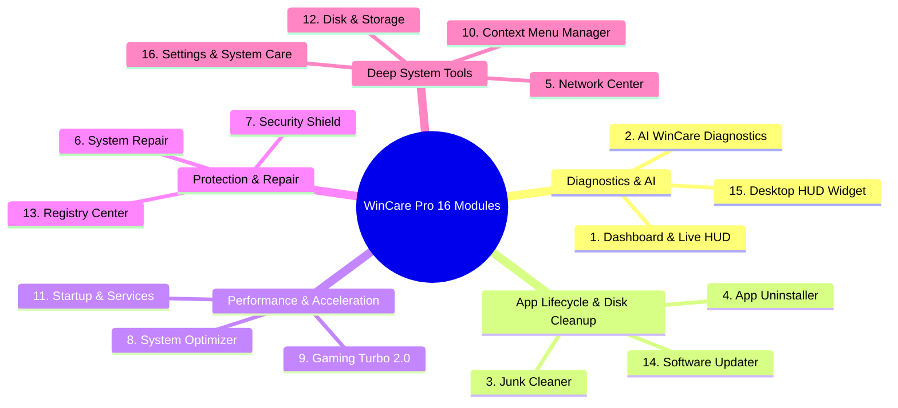

# 🧩 02. Core Functional Modules Detailed Specification

> [⬅️ 01. System Architecture](01_SYSTEM_ARCHITECTURE.md) • [🏠 Documentation Index](README.md) • **Chapter 02** • [Next: 03. Business Logic Engines ➡️](03_ENGINES_AND_BUSINESS_LOGIC.md)

This document provides a comprehensive specification for the 16 functional modules comprising the **WinCare Pro Suite v5.0 (Codename: Polaris)**, covering XAML presentation views, ViewModel orchestrators, business engines, privilege tiers, and safety guarantees.

---

## 📋 Module Overview Map

---

## 1. 📊 Dashboard & Live System HUD

- **Source Code:** [Modules/Dashboard/DashboardView.xaml](../Modules/Dashboard/DashboardView.xaml), [DashboardViewModel.cs](../Modules/Dashboard/DashboardViewModel.cs)
- **Engine Dependencies:** `ProcessService`, `AiWinCareScoringEngine`, `SystemEngine`
- **Objective:** Real-time hardware telemetry ingestion, system status overview, and composite health assessment.
- **Key Capabilities:**
  - **Live Gauges:** Continuous sampling of CPU %, RAM consumption, Disk I/O throughput, and Network upload/download bandwidth.
  - **Composite Health Score (0-100):** Weighted multi-factor score evaluating RAM saturation, accumulated junk metrics, unresolved security warnings, and high-impact autorun processes.
  - **TitleBar HUD Chip:** Mini telemetry strip pinned to the MainWindow titlebar configured with `Typography.NumeralAlignment="Tabular"` to eliminate layout jitter during high-frequency sampling.
  - **Telemetry Sparklines:** Rolling 60-second historical canvas visualizing CPU and memory utilization trends.
- **Safety Rating:** 100% Non-destructive (Read-only OS telemetry).

---

## 2. 🤖 AI Diagnostics & Heuristic Analysis (AI WinCare Engine)

- **Source Code:** [Modules/AiAssistant/AiAssistantView.xaml](../Modules/AiAssistant/AiAssistantView.xaml), [AiAssistantViewModel.cs](../Modules/AiAssistant/AiAssistantViewModel.cs)
- **Engine Dependencies:** [AiDiagnosticsEngine.cs](../Engines/AiDiagnosticsEngine.cs), [AiWinCareEngine.cs](../Engines/AiWinCareEngine.cs)
- **Objective:** Local heuristic diagnosis of degradation risks without transmitting telemetry or telemetry artifacts over the network.
- **Key Capabilities:**
  - **1-Click Deep Scan:** Concurrent asynchronous analysis across 8 system dimensions (Hardware, Memory, Storage, Security, Network, Boot, Residuals, Services).
  - **Predictive Capacity Modeling:** Estimates remaining lifespan before OS system drive (`C:`) exhaustion based on rolling disk write velocity.
  - **Anomalous Process Detection:** Flags runaway background processes sustaining abnormal CPU usage (> 80% for prolonged intervals).
  - **Actionable Remediation Insights:** Surfaces direct execution commands for every detected diagnostic advisory.
- **Safety Rating:** 100% Non-destructive (Diagnostic only).

---

## 3. 🧹 System & Browser Junk Purge (Junk Cleaner)

- **Source Code:** [Modules/JunkCleaner/JunkCleanerView.xaml](../Modules/JunkCleaner/JunkCleanerView.xaml), [JunkCleanerViewModel.cs](../Modules/JunkCleaner/JunkCleanerViewModel.cs)
- **Engine Dependencies:** [JunkCleanerEngine.cs](../Engines/JunkCleanerEngine.cs), [SafePathGuard.cs](../Core/Helpers/SafePathGuard.cs)
- **Objective:** Deep recursive enumeration and safe deletion of ephemeral artifacts, caches, and orphaned files to reclaim disk volume.
- **Purge Scope:**
  - **Windows OS Trees:** `%TEMP%`, `C:\Windows\Temp`, `Prefetch`, Windows Error Reporting (`WER`), Memory Dumps (`*.dmp`), Recycle Bin, Delivery Optimization cache.
  - **Web Browsers:** Google Chrome, Microsoft Edge, Mozilla Firefox, Brave, Opera (Purges Cache, Shader Cache, and optional session cookies).
  - **Third-Party Application Caches:** Discord Cache, Spotify Storage Cache, Adobe Temp, Visual Studio Package & Roslyn compiler cache.
- **Safety Guarantees:** Mandatory path validation via `SafePathGuard.IsSafeToDelete()`. Automatically bypasses locked file handles via `LockingAppService` without crashing.
- **Safety Rating:** Certified Safe (Zero deletion of user personal files or OS binaries).

---

## 4. 📦 Deep Application Removal (App Uninstaller)

- **Source Code:** [Modules/Uninstall/UninstallView.xaml](../Modules/Uninstall/UninstallView.xaml), [UninstallViewModel.cs](../Modules/Uninstall/UninstallViewModel.cs)
- **Engine Dependencies:** [UninstallEngine.cs](../Engines/UninstallEngine.cs)
- **Objective:** Clean uninstallation of Win32 Desktop software and Microsoft Store (UWP/AppX) packages with residual filesystem and registry artifact purging.
- **Key Capabilities:**
  - **Dual-Source Inventory Enumeration:** Aggregates installed software from Registry (`HKLM/HKCU Uninstall` keys) and Windows Package Manager (`PackageManager` COM API).
  - **Residual Leftover Sweep:** Post-uninstall traversal of `AppData\Local`, `AppData\Roaming`, `ProgramData`, and Registry hives to detect lingering artifacts.
  - **Force Uninstall Protocol:** Direct directory quarantine and registry excision for applications with broken native uninstallers.
- **Safety Rating:** High (Surfaces explicit user confirmation dialogs prior to residual deletion).

---

## 5. 🌐 Network Center & DNS Optimization (Network Center)

- **Source Code:** [Modules/Network/NetworkCenterView.xaml](../Modules/Network/NetworkCenterView.xaml), [NetworkCenterViewModel.cs](../Modules/Network/NetworkCenterViewModel.cs)
- **Engine Dependencies:** [NetworkCenterEngine.cs](../Engines/NetworkCenterEngine.cs), [ProcessRunner.cs](../Core/Helpers/ProcessRunner.cs)
- **Objective:** Network throughput benchmarking, DNS server optimization, and network stack restoration.
- **Key Capabilities:**
  - **Speed & Latency Benchmarks:** Measures latency, jitter, download throughput, and upload speeds.
  - **DNS Switcher & Benchmark:** 1-Click DNS switching to Cloudflare (1.1.1.1), Google (8.8.8.8), Quad9, AdGuard (ad-blocking), NextDNS; includes latency benchmarking across all candidates.
  - **Network Repair Stack:** Fully automated network stack reset (Flush DNS, Reset Winsock Catalog, Reset TCP/IP Stack, Release/Renew DHCP Leases).
- **Safety Rating:** Certified Safe (Requires Administrator privileges for DNS switching and Winsock resets).

---

## 6. 🛠️ Operating System Integrity Restoration (System Repair)

- **Source Code:** [Modules/Repair/SystemRepairView.xaml](../Modules/Repair/SystemRepairView.xaml), [SystemRepairViewModel.cs](../Modules/Repair/SystemRepairViewModel.cs)
- **Engine Dependencies:** [SystemRepairEngine.cs](../Engines/SystemRepairEngine.cs), [ProcessRunner.cs](../Core/Helpers/ProcessRunner.cs)
- **Objective:** Comprehensive repair suite for corrupted OS system files, Component Store corruption, and malfunctioning Windows services.
- **Key Capabilities:**
  - **SFC Verification (`sfc /scannow`):** Scans and repairs corrupted core system files against known-good operating system manifests.
  - **DISM Health Restore (`DISM.exe /Online /Cleanup-Image /RestoreHealth`):** Restores Windows Component Store health.
  - **WinSxS Component Cleanup (`/StartComponentCleanup /ResetBase`):** Reclaims gigabytes of disk capacity by purging obsolete update payloads.
  - **Windows Update Subsystem Reset:** Stops `wuauserv`, `bits`, `cryptsvc`, purges corrupted `%windir%\SoftwareDistribution` caches, and restarts services cleanly.
  - **Smart Fix 1-Click Sequence:** Automated remediation pipeline executing repair tasks sequentially.
- **Safety Rating:** Microsoft Native Standard (Administrator privilege required).

---

## 7. 🛡️ Security Posture & Privacy Armor (Security Shield)

- **Source Code:** [Modules/Security/SecurityCenterView.xaml](../Modules/Security/SecurityCenterView.xaml), [SecurityCenterViewModel.cs](../Modules/Security/SecurityCenterViewModel.cs)
- **Engine Dependencies:** [SecurityCenterEngine.cs](../Engines/SecurityCenterEngine.cs)
- **Objective:** Security posture auditing, telemetry suppression, and user privacy protection.
- **Key Capabilities:**
  - **Windows Security State Inspection:** Real-time state inspection of Windows Defender Real-Time Protection, Windows Firewall, and User Account Control (UAC).
  - **Telemetry & Diagnostic Data Suppression:** Disables Windows Diagnostic Data Tracking, Cortana background indexing, and Advertising ID tracking.
  - **App Permissions Management:** Audits and restricts application access to Camera, Microphone, and Location sensors.
  - **Digital Signature Verification (WinTrust):** Validates Authenticode digital signatures for untrusted executables.
- **Safety Rating:** High (Non-destructive policy enforcement).

---

## 8. ⚡ Operating System Tuning & Latency Optimization (System Optimizer)

- **Source Code:** [Modules/SystemOptimizer/SystemOptimizerView.xaml](../Modules/SystemOptimizer/SystemOptimizerView.xaml), [SystemOptimizerViewModel.cs](../Modules/SystemOptimizer/SystemOptimizerViewModel.cs)
- **Engine Dependencies:** [SystemOptimizerEngine.cs](../Engines/SystemOptimizerEngine.cs)
- **Objective:** Windows configuration optimization to minimize kernel latency, boost UI responsiveness, and shed overhead.
- **Key Capabilities:**
  - **RAM Booster Instant Flush (`EmptyWorkingSet`):** Reclaims unused working set memory across idle background processes immediately via Win32 P/Invoke.
  - **Visual Effects Tuning:** Toggles heavy shell drop shadows, animations, and transparency effects on low-resource machines.
  - **System Tweaks:** Registry optimizations targeting Network Throttling Index, SystemResponsiveness, and MenuShowDelay.
  - **Service Optimizer:** Configures non-essential services (Windows Search Indexer, Fax, Telemetry) to Manual/Disabled while enforcing protected service whitelists.
- **Safety Rating:** Certified Safe (Automated pre-tweak registry backup).

---

## 9. 🎮 Gaming & High-Priority Acceleration (Gaming Turbo 2.0)

- **Source Code:** [Modules/GamingTurbo/GamingTurboView.xaml](../Modules/GamingTurbo/GamingTurboView.xaml), [GamingTurboViewModel.cs](../Modules/GamingTurbo/GamingTurboViewModel.cs)
- **Engine Dependencies:** [SystemOptimizerEngine.cs](../Engines/SystemOptimizerEngine.cs), [ProcessService.cs](../Engines/ProcessService.cs)
- **Objective:** Reallocates system scheduling, power profiles, and CPU priorities dynamically during full-screen gaming sessions.
- **Key Capabilities:**
  - **Ultimate Performance Mode:** Automatically switches active Windows power scheme to Ultimate Performance profile.
  - **Automated CPU Priority Elevation:** Detects recognized game executables and elevates scheduling priority to `High Priority` / `Real-Time (I/O)`.
  - **Background Task Throttling:** Suspends non-essential background worker processes during active gaming sessions.
  - **1-Click Game Booster Toggle:** Instant activation and automated restoration of original OS configurations upon exiting game sessions.
- **Safety Rating:** 100% Non-destructive (Transient scheduling adjustments).

---

## 10. 🖱️ Windows Explorer Menu Customization (Context Menu Manager)

- **Source Code:** [Modules/Repair/SystemRepairView.xaml](../Modules/Repair/SystemRepairView.xaml) (Context Menu Tab)
- **Engine Dependencies:** [ContextMenuEngine.cs](../Engines/ContextMenuEngine.cs)
- **Objective:** Manage, hide, or prune context menu items across Windows 10 & 11 shells.
- **Key Capabilities:**
  - **Comprehensive Scope:** Manages File associations (`*`), Folder trees (`Directory`, `Folder`), and Desktop backgrounds (`DesktopBackground`).
  - **Windows 11 Classic vs. Modern Toggle:** Toggles between classic Windows 10 extended context menus and Windows 11 compact modern flyouts.
  - **Backup & Rollback Integration:** Automatically snapshots targeted registry hives prior to mutation.
- **Safety Rating:** Certified Safe.

---

## 11. 📂 Autorun & Windows Service Management (Startup & Services)

- **Source Code:** [Modules/StartupManager/StartupManagerView.xaml](../Modules/StartupManager/StartupManagerView.xaml), [StartupManagerViewModel.cs](../Modules/StartupManager/StartupManagerViewModel.cs)
- **Engine Dependencies:** [StartupEngine.cs](../Engines/StartupEngine.cs), [ServiceSafetyService.cs](../Core/Helpers/ServiceSafetyService.cs)
- **Objective:** Audits and controls applications launching at user logon and background Windows Services/Scheduled Tasks.
- **Key Capabilities:**
  - **Boot Impact Classification:** Categorizes autorun entries by startup delay impact (High, Medium, Low).
  - **Multi-Source Autorun Aggregation:** Enumerates `HKLM/HKCU Run`, User Startup folders, and Task Scheduler autoruns.
  - **Windows Core Service Protection:** [ServiceSafetyService.cs](../Core/Helpers/ServiceSafetyService.cs) locks and blocks attempts to disable vital infrastructure services (`RpcSs`, `WinDefend`, `CryptSvc`, `DcomLaunch`, etc.).
- **Safety Rating:** High (Protected services locked by design).

---

## 12. 💾 Physical Disk Health & Storage Inspection (Disk & Storage Tools)

- **Source Code:** [Modules/Disk/DiskView.xaml](../Modules/Disk/DiskView.xaml), [DiskViewModel.cs](../Modules/Disk/DiskViewModel.cs)
- **Engine Dependencies:** [DiskEngine.cs](../Engines/DiskEngine.cs)
- **Objective:** S.M.A.R.T telemetry extraction, capacity tree analysis, and rapid duplicate file detection.
- **Key Capabilities:**
  - **S.M.A.R.T Drive Diagnostics:** Surfaces drive temperatures, Power-On Hours, read/write error rates, and remaining SSD endurance via WMI and Win32 P/Invoke.
  - **Disk Space Tree Visualizer:** Interactive treemap identifying largest directories and space hogs.
  - **Fast Byte-Hash Duplicate Finder:** Multi-stage comparison combining file size matching with fast SHA-256 block hashing.
- **Safety Rating:** 100% Non-destructive (Diagnostic and user-authorized deletion only).

---

## 13. 🧬 Registry Health & Structural Integrity (Registry Center)

- **Source Code:** [Modules/Registry/RegistryView.xaml](../Modules/Registry/RegistryView.xaml), [RegistryViewModel.cs](../Modules/Registry/RegistryViewModel.cs)
- **Engine Dependencies:** [RegistryBackupEngine.cs](../Engines/RegistryBackupEngine.cs), [SafeRegistryGuard.cs](../Core/Helpers/SafeRegistryGuard.cs)
- **Objective:** Scans, repairs, and defragments invalid registry references with mandatory pre-mutation snapshots.
- **Key Capabilities:**
  - **Registry Issue Scanners:** Detects missing application paths, broken Shared DLL references, invalid file type associations, and orphaned MUI caches.
  - **Mandatory Pre-Remediation Snapshots:** All repair mutations automatically export `.reg` snapshots to `%AppData%\WinCarePro\Backups\`.
  - **1-Click Rollback:** Instant restoration from previously created registry backups.
- **Safety Rating:** Certified Safe (Enforces `SafeRegistryGuard` with subkey depth $\ge 3$).

---

## 14. 🔄 Application Package Update Pipeline (Software Updater)

- **Source Code:** [Modules/Updates/UpdateView.xaml](../Modules/Updates/UpdateView.xaml), [UpdateViewModel.cs](../Modules/Updates/UpdateViewModel.cs)
- **Engine Dependencies:** [SoftwareUpdaterEngine.cs](../Engines/SoftwareUpdaterEngine.cs)
- **Objective:** Audits and batch-updates installed desktop software packages to latest secure releases.
- **Key Capabilities:**
  - **Windows Package Manager Integration:** Interfaces directly with official `winget CLI` repository feeds.
  - **Silent Batch Upgrade Pipeline:** Updates individual packages or batch-executes upgrades in background mode without manual wizard interaction.
  - **Version Differential Visualization:** Displays side-by-side diffs comparing `Current Version` and `Available Version`.
- **Safety Rating:** 100% Safe (Packages sourced strictly from official verified repositories).

---

## 15. 🪟 Desktop Performance Overlay (Desktop HUD Widget)

- **Source Code:** [Modules/DesktopWidget/DesktopWidgetWindow.xaml](../Modules/DesktopWidget/DesktopWidgetWindow.xaml), [DesktopWidgetViewModel.cs](../Modules/DesktopWidget/DesktopWidgetViewModel.cs)
- **Objective:** Lightweight transparent desktop overlay delivering glanceable system performance metrics without opening the primary application window.
- **Key Capabilities:**
  - **Single-Instance Enforcement:** Guarantees exactly one HUD overlay window runs across sessions.
  - **Always on Top & Transparent Glass:** Employs Win32 P/Invoke `SetWindowPos`, `WS_EX_LAYERED`, and `WS_EX_TOOLWINDOW` to suppress Alt+Tab representation and float smoothly.
  - **Resource Discipline:** Consumes $\le 15\text{ MB}$ RAM and $\le 0.2\%$ CPU during idle monitoring.
- **Safety Rating:** 100% Non-destructive.

---

## 16. ⚙️ Application Preferences & Automated Maintenance (Settings & System Care)

- **Source Code:** [Modules/Settings/SettingsView.xaml](../Modules/Settings/SettingsView.xaml), [SettingsViewModel.cs](../Modules/Settings/SettingsViewModel.cs), [Modules/Notifications/NotificationCenterView.xaml](../Modules/Notifications/NotificationCenterView.xaml)
- **Service Dependencies:** `ThemeManager`, `TranslationManager`, `ISettingsService`, `MaintenanceSchedulerService`
- **Objective:** User preferences management, theme customization, dynamic localization, and automated scheduled maintenance.
- **Key Capabilities:**
  - **Dynamic Localization (i18n):** Real-time language switching between **Vietnamese** and **English** without process restarts.
  - **Aura Glass Theme Customization:** Switches between **Dark Mode**, **Light Mode**, and custom Accent colors over Mica Alt.
  - **Automated Maintenance Scheduler:** Configures daily, weekly, or system idle schedules for automated junk purging, RAM flushing, and security audits.
  - **Notification History Center:** Audit trail of system events and background operational outcomes.
- **Safety Rating:** 100% Safe.

---

> [⬅️ 01. System Architecture](01_SYSTEM_ARCHITECTURE.md) • [🏠 Documentation Index](README.md) • **Chapter 02** • [Next: 03. Business Logic Engines ➡️](03_ENGINES_AND_BUSINESS_LOGIC.md)

