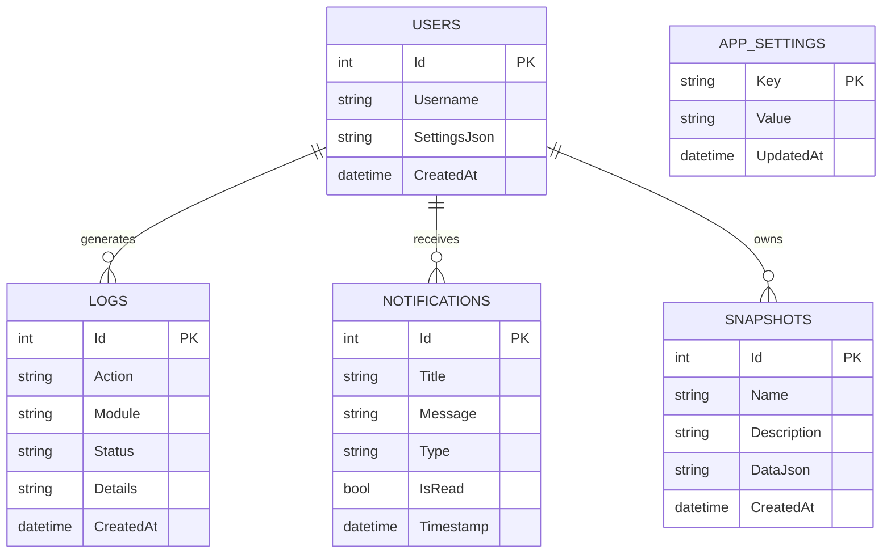

# 💾 04. Database & Storage Architecture

> [⬅️ 03. Business Logic Engines](03_ENGINES_AND_BUSINESS_LOGIC.md) • [🏠 Documentation Index](README.md) • **Chapter 04** • [Next: 05. Security & Safety Standards ➡️](05_SECURITY_AND_SAFETY_ARCHITECTURE.md)

This document details the persistence tier architecture, SQLite 3 database configuration, table schemas, migration strategies, and secure encryption standards across the **WinCare Pro Suite v5.0 (Codename: Polaris)**.

---

## 🗄️ 1. Persistence Tier Overview

WinCare Pro embeds **SQLite 3** via the official `Microsoft.Data.Sqlite` ADO.NET package.

- **Database File Path:** `%AppData%\WinCarePro\wincaredb.db`
- **Data Access Manager:** [Infrastructure/Database/DbManager.cs](../Infrastructure/Database/DbManager.cs)
- **Concurrency Locking:** Centralized synchronization object `private readonly object _dbLock = new();` ensures thread safety across all asynchronous background workers.

---

## ⚡ 2. Performance Tuning Pragmas (SQLite PRAGMAs)

Upon initializing the SQLite connection, `DbManager` executes optimal PRAGMA directives to maximize throughput and guarantee ACID durability:

```sql
-- 1. Enable Write-Ahead Logging (Non-blocking concurrent reads during write transactions)
PRAGMA journal_mode = WAL;

-- 2. Synchronous Normal mode (High write throughput while maintaining power-loss safety)
PRAGMA synchronous = NORMAL;

-- 3. Enforce foreign key constraints
PRAGMA foreign_keys = ON;

-- 4. Allocate 8000 cache pages in memory (~32MB RAM)
PRAGMA cache_size = -8000;

-- 5. Store temporary tables and indices strictly in memory
PRAGMA temp_store = MEMORY;
```

---

## 📊 3. Database Schema

The core relational structure models operational entities as follows:



### 3.1. `Users` Table
Stores configuration profiles and preferences tied to active Windows accounts.

| Column | Data Type | Constraints | Description |
| :--- | :--- | :--- | :--- |
| `Id` | INTEGER | PRIMARY KEY AUTOINCREMENT | Unique record identifier |
| `Username` | TEXT | NOT NULL UNIQUE | Active Windows username (`Environment.UserName`) |
| `Settings` | TEXT | NULL | JSON-serialized user configuration document |
| `CreatedAt` | DATETIME | DEFAULT CURRENT_TIMESTAMP | Profile creation timestamp |

### 3.2. `Logs` Table (Audit Activity Logs)
Maintains historical audit records for all system modifications to enable traceability and Undo rollbacks.

| Column | Data Type | Constraints | Description |
| :--- | :--- | :--- | :--- |
| `Id` | INTEGER | PRIMARY KEY AUTOINCREMENT | Primary Key |
| `Action` | TEXT | NOT NULL | Operation identifier (e.g., "Flush RAM", "Clean Junk") |
| `Module` | TEXT | NOT NULL | Invoking feature module |
| `Status` | TEXT | NOT NULL | "Success" / "Warning" / "Failed" |
| `Details` | TEXT | NULL | Structured telemetry details (freed bytes, deleted keys) |
| `CreatedAt` | DATETIME | DEFAULT CURRENT_TIMESTAMP | Execution timestamp |

*Optimization Index:* `CREATE INDEX idx_logs_module_date ON Logs(Module, CreatedAt DESC);`

### 3.3. `Notifications` Table
Persists alert items displayed within the application Notification Center.

| Column | Data Type | Constraints | Description |
| :--- | :--- | :--- | :--- |
| `Id` | INTEGER | PRIMARY KEY AUTOINCREMENT | Primary Key |
| `Title` | TEXT | NOT NULL | Notification headline |
| `Message` | TEXT | NOT NULL | Detailed payload message |
| `Type` | TEXT | NOT NULL | "Info", "Success", "Warning", "Error" |
| `IsRead` | INTEGER | DEFAULT 0 | Read flag (0: Unread, 1: Read) |
| `Timestamp` | DATETIME | DEFAULT CURRENT_TIMESTAMP | Arrival timestamp |

### 3.4. `Snapshots` Table (System Snapshots & Rollback)
Preserves system configuration states prior to optimization to facilitate 1-Click Undo rollbacks.

| Column | Data Type | Constraints | Description |
| :--- | :--- | :--- | :--- |
| `Id` | INTEGER | PRIMARY KEY AUTOINCREMENT | Primary Key |
| `Name` | TEXT | NOT NULL | Snapshot label |
| `Description` | TEXT | NULL | Pre-mutation activity description |
| `DataJson` | TEXT | NOT NULL | JSON snapshot of registry and service states |
| `CreatedAt` | DATETIME | DEFAULT CURRENT_TIMESTAMP | Snapshot creation timestamp |

### 3.5. `AppSettings` Table
Persists global application key-value configuration pairs.

| Column | Data Type | Constraints | Description |
| :--- | :--- | :--- | :--- |
| `Key` | TEXT | PRIMARY KEY | Configuration key (e.g., "Language", "Theme") |
| `Value` | TEXT | NOT NULL | Assigned value |
| `UpdatedAt` | DATETIME | DEFAULT CURRENT_TIMESTAMP | Last modification timestamp |

---

## 🔄 4. Schema Migration Strategy (`PRAGMA user_version`)

To ensure backward compatibility and reliable database schema upgrades across releases, `DbManager` leverages SQLite's internal `PRAGMA user_version`:

```csharp
public void ApplyMigrations()
{
    lock (_dbLock)
    {
        using var connection = CreateConnection();
        connection.Open();

        using var cmd = connection.CreateCommand();
        cmd.CommandText = "PRAGMA user_version;";
        var currentVersion = Convert.ToInt32(cmd.ExecuteScalar() ?? 0);

        if (currentVersion < 1)
        {
            MigrateToV1(connection);
            SetDatabaseVersion(connection, 1);
        }
        if (currentVersion < 2)
        {
            MigrateToV2(connection);
            SetDatabaseVersion(connection, 2);
        }
        if (currentVersion < 3)
        {
            MigrateToV3(connection);
            SetDatabaseVersion(connection, 3);
        }
    }
}
```

---

## 🔐 5. Sensitive Data Encryption (Windows DPAPI)

For sensitive application settings and security tokens, the system integrates [CryptoHelper.cs](../Core/Helpers/CryptoHelper.cs) utilizing the **Windows Data Protection API (DPAPI)**:

```csharp
public static class CryptoHelper
{
    // Encrypts data bound strictly to the active Windows user account (CurrentUser Scope)
    public static string Protect(string plainText)
    {
        if (string.IsNullOrEmpty(plainText)) return plainText;
        var plainBytes = Encoding.UTF8.GetBytes(plainText);
        var cipherBytes = ProtectedData.Protect(plainBytes, null, DataProtectionScope.CurrentUser);
        return Convert.ToBase64String(cipherBytes);
    }

    // Decrypts ciphertext securely
    public static string Unprotect(string cipherText)
    {
        if (string.IsNullOrEmpty(cipherText)) return cipherText;
        var cipherBytes = Convert.FromBase64String(cipherText);
        var plainBytes = ProtectedData.Unprotect(cipherBytes, null, DataProtectionScope.CurrentUser);
        return Encoding.UTF8.GetString(plainBytes);
    }
}
```

### Architectural Advantages of DPAPI:
1. Zero key storage inside plaintext configuration files (Encryption keys are derived and safeguarded by Windows based on the active user login credentials).
2. Unprivileged accounts or external software executing under separate user contexts cannot decrypt persisted secrets.

---

> [⬅️ 03. Business Logic Engines](03_ENGINES_AND_BUSINESS_LOGIC.md) • [🏠 Documentation Index](README.md) • **Chapter 04** • [Next: 05. Security & Safety Standards ➡️](05_SECURITY_AND_SAFETY_ARCHITECTURE.md)
