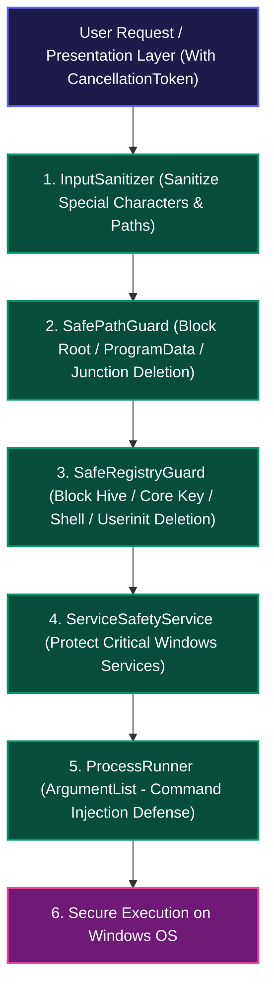

# 🔒 05. Security & Safety Architecture

> [⬅️ 04. Database & Storage](04_DATABASE_AND_STORAGE.md) • [🏠 Docs Index](README.md) • **Chapter 05** • [Next: 06. Background Services & Infrastructure ➡️](06_SERVICES_AND_INFRASTRUCTURE.md)

WinCare Pro performs deep operations on the Windows operating system; therefore, the **Zero-Bug Hardened** safety standard is enforced with the highest priority to eliminate any risk of OS corruption, credential leakage, or exploitation.

---

## 🛡️ 1. Defense-in-Depth Model



---

## 🚫 2. Command Injection Defense (`ProcessRunner`)

- **Source File:** [Core/Helpers/ProcessRunner.cs](../Core/Helpers/ProcessRunner.cs)
- **Security Vulnerability:** Raw string command concatenation (e.g., `cmd.exe /c "tool.exe " + userInput`) introduces severe Command Injection vulnerabilities if user input or package names contain shell control operators such as `&`, `|`, `;`, `powershell -enc`, or `&&`.
- **WinCare Pro Architecture Implementation:**
  - **NEVER** use concatenated string command lines or the legacy `Arguments` property.
  - ALWAYS populate `ProcessStartInfo.ArgumentList`. Each argument is passed directly to the child process `argv` vector by the Windows OS kernel without intermediary shell interpretation.

```csharp
// Standard security pattern in WinCare Pro:
var psi = new ProcessStartInfo
{
    FileName = "winget.exe",
    UseShellExecute = false,
    RedirectStandardOutput = true,
    RedirectStandardError = true,
    CreateNoWindow = true
};
// Append each isolated parameter to ArgumentList
psi.ArgumentList.Add("upgrade");
psi.ArgumentList.Add("--id");
psi.ArgumentList.Add(sanitizedPackageId); // 100% immune to & or | operators
psi.ArgumentList.Add("--silent");
```

---

## 🛡️ 3. Safe Deletion & Credential Shield (`SafePathGuard`)

- **Source File:** [Core/Helpers/SafePathGuard.cs](../Core/Helpers/SafePathGuard.cs)
- **Multi-Tier Protection Mechanics:**

### 3.1. System Protected Roots Blacklist
File deletion and modification are strictly forbidden across critical system trees:
- `C:\Windows`, `C:\Windows\System32`, `C:\Windows\SysWOW64`
- `C:\Windows\WinSxS` (Maintenance strictly limited to DISM)
- `C:\Boot`, `C:\Recovery`, `C:\System Volume Information`
- `C:\ProgramData` (Protected service and application state)
- `C:\Program Files\Windows Defender`

### 3.2. Non-Empty Protection for Non-Recursive Deletions
When invoking directory deletion with `recursive: false`, `SafePathGuard` verifies that the target directory is completely empty. If files or subdirectories remain, the operation is immediately rejected to prevent accidental deletion or unhandled exceptions.

### 3.3. Credential & Session Protection (Credential Shield)
During browser and application junk cleanup scans, `SafePathGuard` automatically excludes files containing credentials, sessions, or cryptographic keys:
- `Login Data`, `Login Data For Account` (Browser passwords)
- `Web Data` (Autofill data)
- `Cookies`, `Cookies-journal`
- `Local State` (Contains DPAPI Master Key for Chromium-based browsers)
- SAM, SYSTEM, and SECURITY hives in `%windir%\System32\config`

### 3.4. Junction Point & Symlink Detection
Prevent directory traversal attacks and link loops via Reparse Points:
```csharp
public static bool IsReparsePoint(string path)
{
    var dirInfo = new DirectoryInfo(path);
    return (dirInfo.Attributes & FileAttributes.ReparsePoint) != 0;
}
```
If a target directory is identified as a Junction Point or Reparse Point pointing elsewhere, the engine skips traversal immediately and refuses recursive deletion.

---

## 🧬 4. Core Registry Protection (`SafeRegistryGuard`)

- **Source File:** [Core/Helpers/SafeRegistryGuard.cs](../Core/Helpers/SafeRegistryGuard.cs)
- **4-Tier Defense Architecture:**

### 4.1. Root Hive Protection
Root hives MUST NEVER be deleted or modified:
- `HKEY_LOCAL_MACHINE`, `HKEY_CURRENT_USER`, `HKEY_CLASSES_ROOT`, `HKEY_USERS`, `HKEY_CURRENT_CONFIG`.

### 4.2. Vital System Key Prefixes
Absolute protection of critical OS configuration branches:
- `HKLM\SYSTEM\CurrentControlSet\Control`
- `HKLM\SOFTWARE\Microsoft\Windows NT\CurrentVersion`

### 4.3. Minimum Key Depth Requirement (Segment Depth ≥ 3)
All registry key deletion operations MUST have a minimum path depth of 3 or more segments (e.g., `SOFTWARE\Vendor\AppName`), preventing accidental wiping of vendor root trees such as `SOFTWARE\Microsoft`.

### 4.4. Critical Boot Value Shield
Prevents mutation or deletion of vital Windows startup pointers:
- `Shell` value (default `explorer.exe`).
- `Userinit` value (default `userinit.exe`).

---

## ⚙️ 5. Windows Core Service Protection (`ServiceSafetyService`)

- **Source File:** [Core/Helpers/ServiceSafetyService.cs](../Core/Helpers/ServiceSafetyService.cs)
- **Problem Statement:** Disabling critical system services can trigger immediate Blue Screen of Death (BSOD), network loss, or login failure.
- **System Core Whitelist:**

| Service Name (`ServiceName`) | Display Name | Consequence if Disabled |
| :--- | :--- | :--- |
| `RpcSs` | Remote Procedure Call | Complete Windows operating system crash |
| `DcomLaunch` | DCOM Server Process Launcher | Complete inability to launch applications |
| `SamSs` | Security Accounts Manager | User authentication failure |
| `ProfSvc` | User Profile Service | User profile loading error |
| `gpsvc` | Group Policy Client | Group policy enforcement failure |
| `BFE` | Base Filtering Engine | Windows Firewall failure |
| `WinDefend` | Microsoft Defender Antivirus | Loss of endpoint antivirus protection |
| `CryptSvc` | Cryptographic Services | Driver and Windows Update failure |
| `EventLog` | Windows Event Log | Loss of OS diagnostics and crash logs |
| `PlugPlay` | Plug and Play | Peripheral and hardware detection failure |
| `RpcEptMapper` | RPC Endpoint Mapper | Breakage of inter-process communication |

`ServiceSafetyService.IsProtectedService(string serviceName)` returns `true` and intercepts/blocks any state mutation request targeting these services.

---

## ⏱️ 6. Task Cancellation Lifecycle & Dispatcher Safety

- **Location:** All ViewModels inheriting `ViewModelBase` and feature modules.
- **CancellationToken Mechanism:**
  - Heavy async operations (I/O, registry scans, junk file deletion, network diagnostics) accept `CancellationToken ct = default`.
  - When the user cancels an operation or navigates away (`Cleanup`), cancellation is immediately propagated, aborting loops safely and releasing locks.
- **UI Dispatcher Safety:**
  - 100% of mutations to Observable properties and `ObservableCollection<T>` from background worker threads MUST be marshaled via `RunOnUI(() => { ... })` (`DispatcherQueue.TryEnqueue`), preventing `COMException (0x8001010E)`.

---

## 🔍 7. Binary Signature Verification (WinTrust API Interop)

- **Source File:** [Engines/Repair/SecurityPrivacyEngine.cs](../Engines/Repair/SecurityPrivacyEngine.cs)
- Native Win32 `WinVerifyTrust` API interop (`wintrust.dll`) validates:
  1. Executable binaries (`.exe`, `.dll`, `.sys`) possess a valid Authenticode signature.
  2. Binary files have not been tampered with or corrupted after signing.
  3. Digital certificates originate from trusted certificate authorities and publishers.

---

## 🛡️ 8. Privileged Elevation Management (UAC Elevation & Manifest)

- UAC execution level defined in [app.manifest](../app.manifest):
  ```xml
  <requestedExecutionLevel level="requireAdministrator" uiAccess="false" />
  ```
- Ensures hardware diagnostics (S.M.A.R.T, SFC, DISM, HKLM Registry mutations, Network Interface Resets) execute without runtime `Access Denied` exceptions.

---

> [⬅️ 04. Database & Storage](04_DATABASE_AND_STORAGE.md) • [🏠 Docs Index](README.md) • **Chapter 05** • [Next: 06. Background Services & Infrastructure ➡️](06_SERVICES_AND_INFRASTRUCTURE.md)

