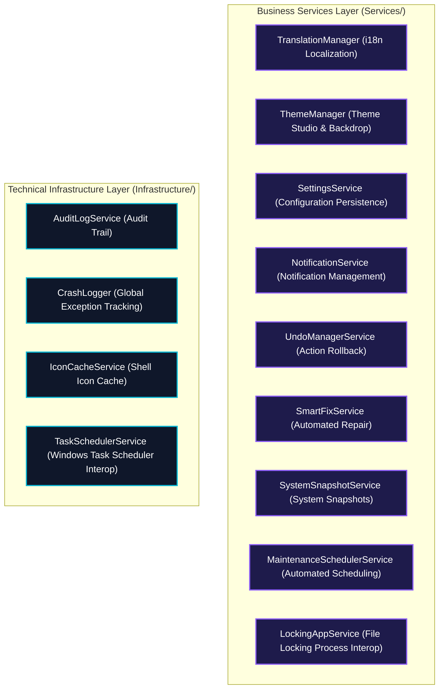

# 🛠️ 06. Services & Infrastructure Layer

> [⬅️ 05. Security & Safety Architecture](05_SECURITY_AND_SAFETY_ARCHITECTURE.md) • [🏠 Docs Index](README.md) • **Chapter 06** • [Next: 07. Aura Glass UI/UX Design System ➡️](07_UI_UX_DESIGN_SYSTEM.md)

This chapter details the background business services (`Services/`) and technical infrastructure modules (`Infrastructure/`) in **WinCare Pro Suite**.

---

## 🏗️ System Service Architecture



---

## 1. 🌐 Internationalization Service (`TranslationManager`)

- **Source Files:** [Services/TranslationService/TranslationManager.cs](../Services/TranslationService/TranslationManager.cs), [TranslationManager.Translations.cs](../Services/TranslationService/TranslationManager.Translations.cs)
- **Mechanics:**
  - Real-time language hot-swapping between **Vietnamese (`vi-VN`)** and **English (`en-US`)** without restarting the application.
  - In-memory fast dictionary lookup via `Dictionary<string, Dictionary<string, string>>`.
  - Extension method in [TranslationExtensions.cs](../Services/TranslationService/TranslationExtensions.cs):
    ```csharp
    public static string Translate(this string key) => TranslationManager.Instance.GetString(key);
    ```
  - Emits the `LanguageChanged` event to notify ViewModels and Views to refresh bound strings.

---

## 2. 🎨 Theme Management Service (`ThemeManager`)

- **Source File:** [Services/ThemeService/ThemeManager.cs](../Services/ThemeService/ThemeManager.cs)
- **Core Features:**
  - **3 Themes:** `Dark` (Modern dark), `Light` (Clean light), and `Cyberpunk` (High-tech neon purple/cyan).
  - **Backdrop Materials:** Supports `MicaAlt`, `Mica`, and `DesktopAcrylic` through Windows App SDK `SystemBackdrop`.
  - **Dynamic Accent Colors:** Real-time `ResourceDictionary` updates applied across the entire XAML visual tree.

---

## 3. ⚙️ Settings Service (`SettingsService`)

- **Source File:** [Services/SettingsService/SettingsService.cs](../Services/SettingsService/SettingsService.cs)
- **Purpose:** Reads and persists user preferences in the `AppSettings` SQLite table.
- **Methods:**
  - `GetAsync<T>(string key, T defaultValue)`: Retrieves strongly-typed configuration values (JSON deserialization).
  - `SetAsync<T>(string key, T value)`: Persists values and triggers configuration change events.

---

## 4. 🔔 Notification Service (`NotificationService`)

- **Source File:** [Services/NotificationService/NotificationService.cs](../Services/NotificationService/NotificationService.cs)
- **Features:**
  - Persists notification history in the `Notifications` SQLite table.
  - Displays Toast notifications via Windows Action Center or In-App InfoBar depending on window state (Active / Minimized to System Tray).
  - Categorizes alerts by severity: `Info`, `Success`, `Warning`, `Error`.

---

## 5. ↩️ Undo Manager Service (`UndoManagerService`)

- **Source File:** [Services/Implementations/UndoManagerService.cs](../Services/Implementations/UndoManagerService.cs)
- **Purpose:** Records executed system configuration mutations (Registry edits, Service state changes, DNS overrides) onto an undo stack.
- **Rule:** Every operation invoked via `ExecuteAction(forwardAction, rollbackAction)` MUST provide an idempotent `rollbackAction` to enable safe state reversion.

---

## 6. 📸 System Snapshot Service (`SystemSnapshotService`)

- **Source File:** `Services/SystemSnapshotService/SystemSnapshotService.cs`
- **Purpose:** Captures an end-to-end system state snapshot prior to major optimization routines:
  - Backs up active registry tweak configurations.
  - Persists current start types of all Windows Services.
  - Records the startup application catalog.
- Enables point-in-time state rollback from historical snapshots.

---

## 7. ⏰ Maintenance Scheduler Service (`MaintenanceSchedulerService`)

- **Source File:** `Services/MaintenanceSchedulerService/MaintenanceSchedulerService.cs`
- **Features:**
  - Integrates with `TaskSchedulerService` to schedule periodic maintenance in Windows Task Scheduler (`schtasks.exe`).
  - Supports triggers: **Daily**, **Weekly**, or **On System Idle**.
  - Silently executes junk cleaning, RAM reclamation, and package upgrade checks in the background.

---

## 8. 🖼️ Shell Icon Cache Service (`IconCacheService`)

- **Source File:** [Infrastructure/Caching/IconCacheService.cs](../Infrastructure/Caching/IconCacheService.cs)
- **Performance Rationale:** Extracting icons (`SHGetFileInfo` / `ExtractIconEx`) for hundreds of running processes and installed packages directly from disk induces thread contention and frame stutter.
- **Implementation:**
  - In-memory `ConcurrentDictionary<string, ImageSource>` cache.
  - Extracts the binary icon on initial lookup; subsequent queries return immediately with $O(1)$ latency.

---

## 9. 📝 Audit Logging & Global Crash Tracking (`AuditLogService` & `CrashLogger`)

- **Source Files:** [Infrastructure/Logging/AuditLogService.cs](../Infrastructure/Logging/AuditLogService.cs), [Infrastructure/Logging/CrashLogger.cs](../Infrastructure/Logging/CrashLogger.cs)
- **`AuditLogService`:** Logs every cleanup, optimization, or repair action to SQLite with exact timestamps and return codes.
- **`CrashLogger`:** Traps unhandled process exceptions (`AppDomain.CurrentDomain.UnhandledException` and `TaskScheduler.UnobservedTaskException`), generating structured logs at `%LocalAppData%\WinCarePro\CrashLogs\crash_YYYYMMDD_HHmmss.log` for post-mortem diagnostics.

---

> [⬅️ 05. Security & Safety Architecture](05_SECURITY_AND_SAFETY_ARCHITECTURE.md) • [🏠 Docs Index](README.md) • **Chapter 06** • [Next: 07. Aura Glass UI/UX Design System ➡️](07_UI_UX_DESIGN_SYSTEM.md)

