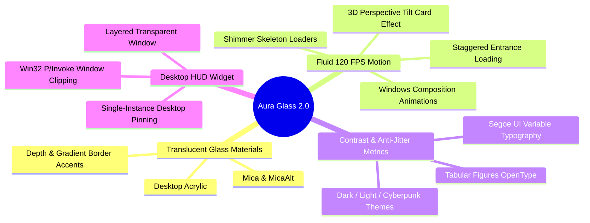

# 🎨 07. UI/UX Design System (Aura Glassmorphic Fluent 2.0)

> [⬅️ 06. Background Services & Infrastructure](06_SERVICES_AND_INFRASTRUCTURE.md) • [🏠 Docs Index](README.md) • **Chapter 07** • [Next: 08. Automated Testing & QA ➡️](08_TESTING_AND_QUALITY_ASSURANCE.md)

WinCare Pro Suite is built upon the proprietary **Aura Glassmorphic Fluent 2.0** design system, combining the capabilities of **WinUI 3 (Windows App SDK)** and the **Windows Composition API** to deliver a responsive, fluid, and premium desktop experience on Windows.

---

## 💎 1. Core Visual Pillars



---

## 🪟 2. Translucent Backdrop Materials

WinCare Pro dynamically adapts its backdrop material based on user preferences and system hardware capabilities:

- **Mica / MicaAlt:** Windows 11 exclusive material that blends the desktop wallpaper palette with the application window without GPU performance overhead.
- **Desktop Acrylic:** Translucent backdrop with Gaussian blur sampling for deep glass aesthetics on both Windows 10 and Windows 11.
- **Hardware Fallback in [MainWindow.Win32.cs](../MainWindow.Win32.cs):**
  - Automatically falls back to high-contrast Solid Color when running on virtual machines or GPUs without hardware acceleration.

---

## ✨ 3. Motion & Animation Architecture

- **Source Files:** [Core/Helpers/AnimationHelper.cs](../Core/Helpers/AnimationHelper.cs), [Core/Helpers/Animation3DHelper.cs](../Core/Helpers/Animation3DHelper.cs)

### 3.1. Interactive 3D Perspective Tilt (3D Card Perspective Tilt)
When the user hovers over feature cards on the dashboard:
- `Animation3DHelper` calculates the delta vector between the card center and mouse coordinates $(X, Y)$.
- Applies spatial transformation via `Matrix4x4` or `RotationAngleInDegrees` through the Windows Composition Visual Layer, tilting the card dynamically toward the user's focal point.

### 3.2. Staggered Entrance Animations
During navigation transitions in `NavigationView`:
- Visual elements (cards, table rows, telemetry charts) do not appear simultaneously; they are scheduled with incremental millisecond offsets:
  $$\text{Delay}_i = i \times 40\text{ ms}$$
- Combines composition `FadeIn` and upward `SlideIn` for seamless, lightweight visual transitions.

### 3.3. Shimmer Skeleton Loaders
- During heavy background I/O or WMI diagnostic queries, interface cards display horizontal shimmering gradients rather than modal spinners, preserving visual stability and indicating incoming layout structure.

---


## ⏱️ 4. Anti-Jitter Fixed Typography (Tabular Figures)

- **Problem Statement:** During real-time telemetry updates (CPU, RAM, network throughput) executed every 1000 ms, character glyph widths for numerals (`1`, `8`, `0`) vary dynamically in proportional fonts. This variance causes text labels to resize horizontally and jitter.
- **WinCare Pro Architecture Solution:**
  - Enforces OpenType **Tabular Figures** (`tnum`) across all telemetry TextBlocks:
  ```xml
  <TextBlock Text="{x:Bind ViewModel.CpuUsageText, Mode=OneWay}"
             FontTypography.NumeralAlignment="Tabular"
             FontFamily="Segoe UI Variable Display" />
  ```
  - Digits $0$ through $9$ share identical bounding box widths, guaranteeing visual stability on TitleBar HUD chips and dashboard counters.

---

## 🪟 5. Desktop Mini-HUD Architecture (Desktop HUD Widget)

- **Source File:** [Modules/DesktopWidget/DesktopWidgetWindow.xaml](../Modules/DesktopWidget/DesktopWidgetWindow.xaml)
- **Win32 P/Invoke Mechanics:**
  1. **Taskbar & Alt+Tab Suppression:** Sets `WS_EX_TOOLWINDOW` and removes `WS_EX_APPWINDOW`.
  2. **Topmost Pinning (Always on Top):** Invokes `SetWindowPos(hwnd, HWND_TOPMOST, ...)`.
  3. **Seamless Dragging:** Intercepts `PointerPressed` on the widget title bar, calling `ReleaseCapture` coupled with `SendMessage(hwnd, WM_NCLBUTTONDOWN, HT_CAPTION, 0)`.
  4. **Single-Instance Mutex:** Utilizes a named system `Mutex` to guarantee that exactly one HUD widget runs concurrently.

---

## 🎨 6. Theme Studio Color Palettes

WinCare Pro provides 3 distinct palettes compliant with WCAG AAA contrast guidelines:

| UI Component | Dark Theme (Default) | Light Theme | Cyberpunk Neon |
| :--- | :--- | :--- | :--- |
| **Main Background** | `#0D1117` / `#161B22` | `#F6F8FA` / `#FFFFFF` | `#080114` / `#12072B` |
| **Accent Color** | `#7F56D9` (Aura Violet) | `#6941C6` (Royal Purple) | `#00F2FE` & `#FE0979` |
| **Card Border** | `rgba(255,255,255,0.08)` | `rgba(0,0,0,0.06)` | `rgba(0,242,254,0.3)` |
| **Header Text** | `#F0F6FC` | `#1F2328` | `#00F2FE` |
| **Healthy / Success** | `#2EA043` (Emerald) | `#1A7F37` (Forest Green) | `#00FF9D` (Neon Lime) |
| **Warning** | `#D29922` (Amber) | `#9A6700` (Warm Ochre) | `#FFD000` (Bright Yellow)|
| **Danger / Error** | `#F85149` (Coral Red) | `#CF222E` (Crimson) | `#FF0055` (Neon Red) |

---

> [⬅️ 06. Background Services & Infrastructure](06_SERVICES_AND_INFRASTRUCTURE.md) • [🏠 Docs Index](README.md) • **Chapter 07** • [Next: 08. Automated Testing & QA ➡️](08_TESTING_AND_QUALITY_ASSURANCE.md)

