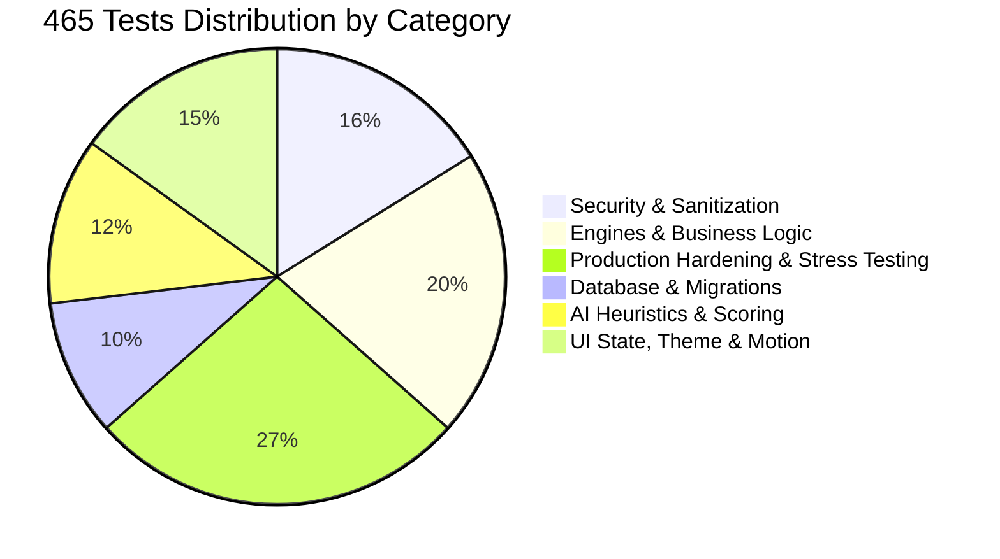

# 🧪 08. Automated Testing & Quality Assurance (QA & Testing)

> [⬅️ 07. Aura Glass UI/UX Design System](07_UI_UX_DESIGN_SYSTEM.md) • [🏠 Docs Index](README.md) • **Chapter 08** • [Next: 09. Build, Deployment & CI/CD ➡️](09_BUILD_DEPLOYMENT_AND_PACKAGING.md)

Software quality and operational safety are verified through a comprehensive automated test suite in the `WinCarePro.Tests` project, featuring **465 xUnit test cases with a 100% pass rate (465/465 Passed — Zero-Bug Policy)**.

---

## 📊 1. Test Suite Overview

- **Framework:** `xUnit.net v2`
- **Mocking & Assertion Libraries:** `Moq`, `FluentAssertions`
- **Execution Target:** Windows 10/11 x64 (.NET 10.0 runtime)
- **Directory Location:** [WinCarePro.Tests/](../WinCarePro.Tests/)



---

## 🗂️ 2. Test Classes & Coverage Catalog

| # | Test File | Test Category | Target Scope & Invariants |
| :---: | :--- | :--- | :--- |
| **1** | [SecurityAndSafetyTests.cs](../WinCarePro.Tests/SecurityAndSafetyTests.cs) | Safety & Guard Rails | Tests `SafePathGuard` root tree protection, Reparse Point bypass, credential file exclusion. |
| **2** | [ProductionHardeningTests.cs](../WinCarePro.Tests/ProductionHardeningTests.cs) | Hardening & OS Protection | Tests `SafeRegistryGuard`, `ServiceSafetyService` core whitelist, safe `CancellationToken` thread interruption. |
| **3** | [ProductionStressHardeningTests.cs](../WinCarePro.Tests/ProductionStressHardeningTests.cs) | Stress Testing & Concurrency | Tests repeated Scan-Cancel cycles across ViewModels, theme/language hot-swapping during active jobs, double-click debounce. |
| **4** | [LifecycleAndStressHardeningTests.cs](../WinCarePro.Tests/LifecycleAndStressHardeningTests.cs) | Lifecycle & State Transitions | Tests safe `Dispose()` during in-flight operations, state machine race condition prevention under rapid navigation. |
| **5** | [SecurityAndSanitizationTests.cs](../WinCarePro.Tests/SecurityAndSanitizationTests.cs) | Injection Defense | Validates `InputSanitizer` and `ProcessRunner.ArgumentList` rejection of malicious shell metacharacters. |
| **6** | [AppVersionManagementTests.cs](../WinCarePro.Tests/AppVersionManagementTests.cs) | Version Management | Verifies synchronized versioning: v5.1.1 (Polaris), DefaultVersionString, InformationalVersion, and AppConstants. |
| **7** | [DbManagerRegressionTests.cs](../WinCarePro.Tests/DbManagerRegressionTests.cs) | SQLite Database & WAL | Tests `PRAGMA user_version` migrations and multithreaded `_dbLock` concurrency. |
| **8** | [DbAndReportTests.cs](../WinCarePro.Tests/DbAndReportTests.cs) | Persistence & Reporting | Tests CRUD operations on `Logs`, `Users`, and `Notifications` tables, plus analytical queries. |
| **9** | [AiDiagnosticsEngineTests.cs](../WinCarePro.Tests/AiDiagnosticsEngineTests.cs) | AI Diagnostics Engine | Assesses 8 concurrent heuristic diagnostic tasks and severity categorization accuracy. |
| **10** | [AiWinCareEngineTests.cs](../WinCarePro.Tests/AiWinCareEngineTests.cs) | Health Scoring Algorithm | Validates `Composite Health Score` (0-100) formulas against boundary edge cases. |
| **11** | [DriverBackupAndAiForecastingTests.cs](../WinCarePro.Tests/DriverBackupAndAiForecastingTests.cs) | AI Forecasting & Drivers | Tests disk space exhaustion forecasting extrapolation and driver backup export logic. |
| **12** | [JunkCleanerEngineTests.cs](../WinCarePro.Tests/JunkCleanerEngineTests.cs) | Junk Cleaning Logic | Verifies byte capacity calculations and locked-file skipping without scan aborts. |
| **13** | [SystemOptimizerEngineTests.cs](../WinCarePro.Tests/SystemOptimizerEngineTests.cs) | RAM Reclaim & Tweaks | Tests Win32 `EmptyWorkingSet` invocations and safe registry DWORD mutations. |
| **14** | [SystemRepairTests.cs](../WinCarePro.Tests/SystemRepairTests.cs) | Windows System Repair | Tests SFC, DISM execution pipelines and `ExitCode` parsing resilience. |
| **15** | [NetworkCenterEngineTests.cs](../WinCarePro.Tests/NetworkCenterEngineTests.cs) | Network & DNS Engine | Tests ICMP ping latency, DNS benchmark resolution, and network stack reset sequences. |
| **16** | [UninstallEngineTests.cs](../WinCarePro.Tests/UninstallEngineTests.cs) | Software Uninstaller | Tests post-uninstall leftover file analysis and orphaned registry key cleanup. |
| **17** | [CryptoHelperTests.cs](../WinCarePro.Tests/CryptoHelperTests.cs) | DPAPI Encryption | Tests DPAPI `Protect` encryption and `Unprotect` decryption symmetry. |
| **18** | [UiThemeAndConsistencyTests.cs](../WinCarePro.Tests/UiThemeAndConsistencyTests.cs) | UI Consistency & i18n | Validates bilingual dictionary parity between `vi-VN` and `en-US` (zero missing keys). |

---

## 🚀 3. Test Execution Guidelines

### 3.1. Execute Full Test Suite via .NET CLI

Open PowerShell at the project root directory and execute:

```powershell
dotnet test WinCarePro.Tests/WinCarePro.Tests.csproj --verbosity normal
```

### 3.2. Targeted Category Execution

- **Run Security & Safety Tests:**
  ```powershell
  dotnet test WinCarePro.Tests/WinCarePro.Tests.csproj --filter "FullyQualifiedName~Security"
  ```

- **Run Database & Concurrency Tests:**
  ```powershell
  dotnet test WinCarePro.Tests/WinCarePro.Tests.csproj --filter "FullyQualifiedName~Db"
  ```

- **Generate TRX Test Report:**
  ```powershell
  dotnet test WinCarePro.Tests/WinCarePro.Tests.csproj --logger "trx;LogFileName=TestResults.trx"
  ```

---

## 🛡️ 4. Test Safety Invariants & Execution Rules

1. **Isolation & In-Memory Database:** Database unit tests utilize transient in-memory SQLite instances (`Data Source=:memory:`) or isolated test databases inside `TestTemp/`, cleaned up automatically upon test completion.
2. **Mocking External OS Operations:** Operations that mutate host OS state (e.g., `sfc /scannow`, `EmptyWorkingSet`, `KillProcess`) MUST be mocked or executed within safe dummy harnesses to guarantee developer workstations remain untouched.
3. **Assertive Invariants & Edge Cases:** All test cases MUST validate edge boundaries (empty strings, null paths, malicious injection metacharacters, negative integers) to ensure zero unhandled `NullReferenceException` or `ArgumentException` failures.

---

> [⬅️ 07. Aura Glass UI/UX Design System](07_UI_UX_DESIGN_SYSTEM.md) • [🏠 Docs Index](README.md) • **Chapter 08** • [Next: 09. Build, Deployment & CI/CD ➡️](09_BUILD_DEPLOYMENT_AND_PACKAGING.md)

