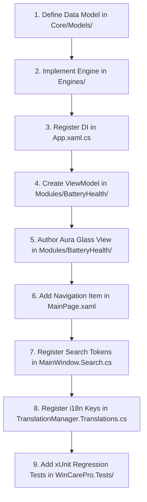

# 👨‍💻 10. Developer Onboarding Guide

> [⬅️ 09. Build, Deployment & CI/CD](09_BUILD_DEPLOYMENT_AND_PACKAGING.md) • [🏠 Docs Index](README.md) • **Chapter 10** • [Next: 11. End-User Manual ➡️](11_USER_MANUAL_VI.md)

Welcome to the **WinCare Pro Suite** engineering team. This guide outlines the development environment setup and provides a step-by-step walkthrough for creating a new feature module following our 4-tier architectural invariants.

---

## 💻 1. Development Environment Setup

1. **Visual Studio 2022 Installation:**
   - Install **Community**, **Professional**, or **Enterprise** (v17.10+).
   - In *Visual Studio Installer*, enable the following workloads:
     - **.NET Desktop Development** (Includes .NET 10.0 SDK & C# 13).
     - **Windows application development** (Includes Windows App SDK C# Templates).
2. **Inno Setup 6 Installation:** (Required for packaging and testing `WinCareProSetup.exe`).
3. **Open Solution:**
   - Open `WinCarePro.sln` or the workspace directory in Visual Studio.
   - Press `Ctrl + Shift + B` to rebuild the solution and ensure zero errors or warnings.

---

## 📐 2. Coding Standards & Architectural Invariants

The project enforces strict modern C# and WinUI 3 architectural rules:

- **Asynchronous Operations (Async/Await):** All I/O, disk traversal, or Win32 API calls MUST be suffixed with `Async` and accept `CancellationToken ct = default` (e.g., `Task<OperationResult<T>> ScanItemsAsync(CancellationToken ct = default)`).
- **Thread Marshaling:** Direct modification of UI controls or `ObservableCollection<T>` from worker threads is STRICTLY FORBIDDEN. ALWAYS dispatch UI updates via `RunOnUI(() => { ... })` in `ViewModelBase`.
- **Exception Discipline:** Silent exception swallowing (`catch { }`) is STRICTLY FORBIDDEN. All fallible routines MUST return `OperationResult.Fail(message, ex)` and log unexpected exceptions via `CrashLogger.LogError`.
- **Zero Hardcoded Strings:** User-facing strings MUST be registered in both `vi-VN` and `en-US` dictionaries within `TranslationManager.Translations.cs` and resolved via `"Key".Translate()` or XAML `TranslationConverter`.

---

## 🛠️ 3. Step-by-Step Walkthrough: Adding a New Module

Example scenario: Implementing a new **BatteryHealth** module (laptop battery diagnostics and health telemetry):



### Step 1: Define the Data Model
Create `Core/Models/BatteryInfo.cs`:
```csharp
namespace WinCarePro.Core.Models;

public class BatteryInfo
{
    public double HealthPercentage { get; set; }
    public int CycleCount { get; set; }
    public double DesignedCapacityMWh { get; set; }
    public double FullChargeCapacityMWh { get; set; }
    public bool IsCharging { get; set; }
}
```

### Step 2: Implement the Engine
Create `Engines/Diagnostics/BatteryEngine.cs`:
```csharp
namespace WinCarePro.Engines.Diagnostics;

public class BatteryEngine
{
    public async Task<OperationResult<BatteryInfo>> GetBatteryReportAsync(CancellationToken ct = default)
    {
        try
        {
            // Execute secure Windows battery report extraction
            var result = await ProcessRunner.RunAsync("powercfg", new[] { "/batteryreport", "/output", "battery.xml", "/xml" }, ct);
            if (!result.Success) return OperationResult<BatteryInfo>.Fail("Cannot query battery status");

            var info = ParseBatteryXml("battery.xml");
            return OperationResult<BatteryInfo>.Ok(info);
        }
        catch (Exception ex)
        {
            return OperationResult<BatteryInfo>.Fail("Failed to analyze battery", ex);
        }
    }
}
```


### Step 3: Register Dependency Injection in `App.xaml.cs`
Open [App.xaml.cs](../App.xaml.cs) and register the services:
```csharp
services.AddSingleton<BatteryEngine>();
services.AddTransient<BatteryViewModel>();
```

### Step 4: Implement the ViewModel
Create `Modules/BatteryHealth/BatteryViewModel.cs`:
```csharp
namespace WinCarePro.Modules.BatteryHealth;

public partial class BatteryViewModel : ViewModelBase
{
    private readonly BatteryEngine _engine;

    [ObservableProperty]
    private BatteryInfo _batteryInfo;

    [ObservableProperty]
    private bool _isLoading;

    public BatteryViewModel(BatteryEngine engine)
    {
        _engine = engine;
    }

    [RelayCommand]
    public async Task LoadDataAsync()
    {
        IsLoading = true;
        var result = await Task.Run(() => _engine.GetBatteryReportAsync());
        RunOnUI(() =>
        {
            if (result.Success) BatteryInfo = result.Data;
            IsLoading = false;
        });
    }
}
```

### Step 5: Author the Aura Glass View
Create `Modules/BatteryHealth/BatteryPage.xaml` and `BatteryPage.xaml.cs`:
```xml
<Page x:Class="WinCarePro.Modules.BatteryHealth.BatteryPage"
      xmlns="http://schemas.microsoft.com/winfx/2006/xaml/presentation"
      xmlns:x="http://schemas.microsoft.com/winfx/2006/xaml">
    <Grid Padding="24">
        <!-- Apply Aura Glass Card Style -->
        <Border Style="{StaticResource AuraGlassCardStyle}">
            <StackPanel Spacing="12">
                <TextBlock Text="{x:Bind ViewModel.TitleText, Mode=OneWay}" Style="{StaticResource SubtitleTextBlockStyle}"/>
                <ProgressBar Value="{x:Bind ViewModel.BatteryInfo.HealthPercentage, Mode=OneWay}" Maximum="100"/>
            </StackPanel>
        </Border>
    </Grid>
</Page>
```

### Steps 6 & 7: Navigation & Global Search Registration
- Open [MainPage.xaml](../MainPage.xaml) and add the corresponding `NavigationViewItem`.
- Open [MainWindow.Search.cs](../MainWindow.Search.cs) and register search keyword tags (`"battery"`, `"pin"`, `"powercfg"`) for quick TitleBar indexing.

### Step 8: Register Bilingual Translation Keys
Open [TranslationManager.Translations.cs](../Services/TranslationService/TranslationManager.Translations.cs):
```csharp
["vi-VN"]["Nav_Battery"] = "Sức Khỏe Pin";
["en-US"]["Nav_Battery"] = "Battery Health";
```

### Step 9: Author xUnit Unit Tests
Create `WinCarePro.Tests/BatteryEngineTests.cs`:
```csharp
[Fact]
public async Task BatteryEngine_ShouldParseReportCorrectly()
{
    var engine = new BatteryEngine();
    var res = await engine.GetBatteryReportAsync();
    res.Success.Should().BeTrue();
}
```

---

## 🐛 4. Diagnostics & Debugging Tips

- **Inspect Audit Logs:** Open `%LocalAppData%\WinCarePro\wincaredb.db` via *DB Browser for SQLite* to query records in the `Logs` table.
- **Inspect Crash Logs:** Review `%LocalAppData%\WinCarePro\CrashLogs\` for unhandled exception stack traces.
- **XAML Live Preview:** Leverage XAML Hot Reload and Live Visual Tree in Visual Studio 2022 to adjust paddings, brush opacities, and animations live at runtime.

---

> [⬅️ 09. Build, Deployment & CI/CD](09_BUILD_DEPLOYMENT_AND_PACKAGING.md) • [🏠 Docs Index](README.md) • **Chapter 10** • [Next: 11. End-User Manual ➡️](11_USER_MANUAL_VI.md)

