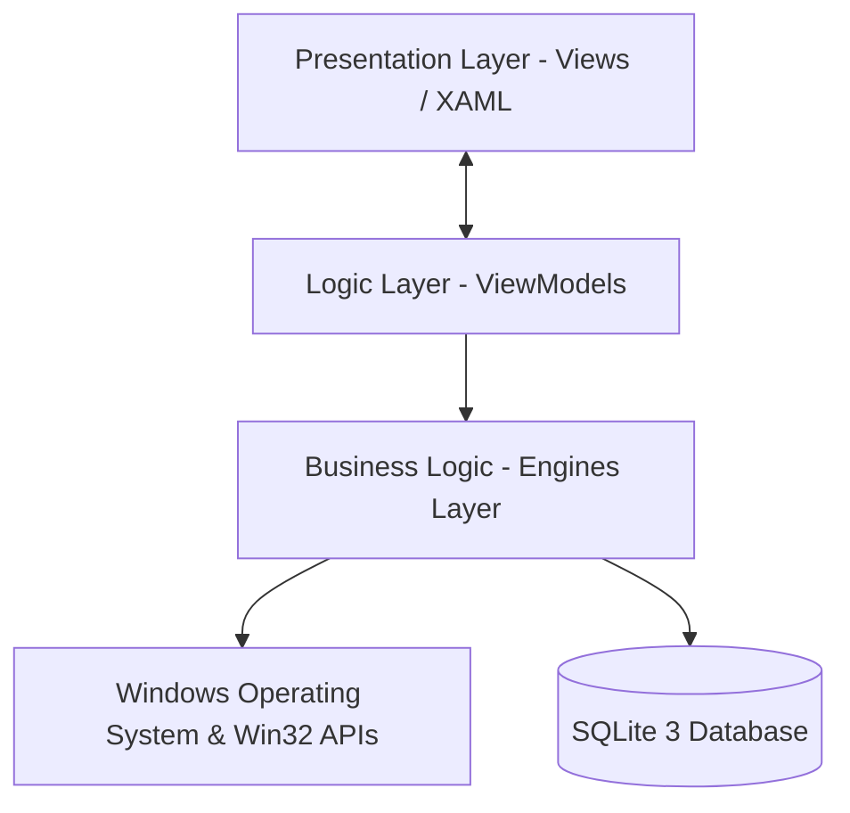

# 📘 Developer & Architecture Guide

> [🏠 Docs Hub (README.md)](README.md) • [10. Developer Onboarding Guide](10_DEVELOPER_ONBOARDING_GUIDE.md)

This document provides a concise overview for software engineers and systems architects seeking to understand the architecture, design patterns, security guarantees, and performance standards of **WinCare Pro Suite**. For the complete 11-chapter architectural reference, visit the **[Docs Hub](README.md)**.

---

## 🏛️ 1. Modular MVVM Architecture

WinCare Pro adheres strictly to the **MVVM (Model-View-ViewModel)** architectural pattern on Windows App SDK (WinUI 3). The codebase is partitioned into distinct layers to guarantee testability and maintainability:



### 1.1. Presentation Layer (View Layer)
- Location: `Modules/`, `MainWindow.xaml`, `MainPage.xaml`
- Built on **Fluent 2.0 Aura Glass** design aesthetics with Mica, Acrylic, and smooth composition animations.
- Declared in XAML with UI logic isolated in code-behind (`.xaml.cs`). Code-behind is strictly limited to graphical effects, animations, and native Win32 windowing hooks (e.g., window subclassing for minimum size enforcement).

### 1.2. ViewModel Layer
- Location: `Modules/<Feature>/` (e.g., `Modules/JunkCleaner/JunkViewModel.cs`)
- Built on **CommunityToolkit.Mvvm**.
- Inherits from `ViewModelBase`, leveraging `[ObservableProperty]` for data binding and `[RelayCommand]` for user interactions.
- Communicates with Views via two-way data binding and command bindings. Holds zero direct references to WinUI XAML controls, ensuring pure headless execution in unit tests.

### 1.3. Engines & Services Layer
- Location: `Engines/`, `Services/`
- Encapsulates system business logic and diagnostic algorithms.
- Registered in the Dependency Injection (DI) container in [App.xaml.cs](../App.xaml.cs) and injected into ViewModel constructors.
- Heavy I/O routines and Win32 invocations MUST execute asynchronously via `Task.Run` or `ProcessRunner.RunAsync` to preserve 60-120 FPS UI thread responsiveness.

---

## 💾 2. Database & Persistence Layer

The application utilizes an embedded **SQLite 3** database managed via `Microsoft.Data.Sqlite`.

### 2.1. Database Configuration
- **Source File:** [DbManager.cs](../Infrastructure/Database/DbManager.cs)
- **Database File:** `%LocalAppData%\WinCarePro\wincaredb.db`
- **Performance & Concurrency Hardening:**
  - **Write-Ahead Logging (WAL):** Enabled via `PRAGMA journal_mode=WAL;`, allowing concurrent readers without writer contention.
  - **Synchronous Normal:** Configured via `PRAGMA synchronous=NORMAL;` for optimal write throughput while preventing journal corruption.
  - **Thread-Safety:** Centralized synchronization via `lock (_dbLock)` ensures safe concurrent execution across background worker threads.

### 2.2. Database Schema

#### `Users` Table (User Profile & Configuration)
| Column | Data Type | Attributes | Description |
| :--- | :--- | :--- | :--- |
| `Id` | INTEGER | PRIMARY KEY AUTOINCREMENT | Primary surrogate key |
| `Username` | TEXT | NOT NULL | Windows NT user account identity |
| `Settings` | TEXT | - | Serialized JSON configuration payload |
| `CreatedAt` | DATETIME | DEFAULT CURRENT_TIMESTAMP | Record creation timestamp |

#### `Logs` Table (Audit Trail)
| Column | Data Type | Attributes | Description |
| :--- | :--- | :--- | :--- |
| `Id` | INTEGER | PRIMARY KEY AUTOINCREMENT | Primary surrogate key |
| `Action` | TEXT | NOT NULL | Action identifier (e.g., "Booster RAM") |
| `Module` | TEXT | NOT NULL | Module name (e.g., "System Optimizer") |
| `Status` | TEXT | NOT NULL | Execution status ("Success" or "Failed") |
| `CreatedAt` | DATETIME | DEFAULT CURRENT_TIMESTAMP | Action execution timestamp |

* Index: `idx_logs_module_createdat` on `(Module, CreatedAt DESC)` optimizes dashboard telemetry and history queries.

#### `UpdatedApps` Table (Software Update Tracking)
| Column | Data Type | Attributes | Description |
| :--- | :--- | :--- | :--- |
| `AppId` | TEXT | PRIMARY KEY | Unique package identifier (e.g., "7zip.7zip") |
| `Version` | TEXT | NOT NULL | Successfully installed version string |
| `UpdatedAt` | DATETIME | DEFAULT CURRENT_TIMESTAMP | Update installation timestamp |

---

## ⚙️ 3. Core Engine Execution Pipelines

### 3.1. JunkCleanerEngine (Junk File Cleansing)
- **Source File:** [JunkCleanerEngine.cs](../Engines/Optimization/JunkCleanerEngine.cs)
- **Target Directories:** Windows and User Temp directories, Chromium/Gecko/Edge browser caches, system logs, Windows Error Reports, shell icon and font caches.
- **Safety Invariants:**
  - Reparse Point Inspection: Validates `FileAttributes.ReparsePoint` before recursion to avoid following directory junctions, symlinks, or infinite directory traversal loops.
  - Zero-Reboot-Queue Policy: Silently skips in-use locked files without scheduling deferred deletions via `MoveFileEx(MOVEFILE_DELAY_UNTIL_REBOOT)`.

### 3.2. SoftwareUpdaterEngine (Package Upgrade Management)
- **Source File:** [SoftwareUpdaterEngine.cs](../Engines/Repair/SoftwareUpdaterEngine.cs)
- **Execution Pipeline:**
  1. Inspects Windows registry uninstall keys to detect installed package versions.
  2. Queries update endpoints or local catalogs for upstream versions.
  3. Downloads release binaries into temporary staging storage via `HttpClient`.
  4. **Authenticode Signature Verification:** Emits `X509Certificate2` cryptographic checks and calls `WinVerifyTrust`. Executes exclusively when digital signatures are valid (`cert.Verify() == true`).
  5. Launches silent deployment switches (`/VERYSILENT` for Inno Setup, `/qn` for MSI).

### 3.3. SystemOptimizerEngine (Performance & Working Set Reclamation)
- **Source File:** [SystemOptimizerEngine.cs](../Engines/Optimization/SystemOptimizerEngine.cs)
- **RAM Booster (Working Set Trim):**
  - Iterates running non-system processes.
  - Calls native Win32 `EmptyWorkingSet(hProcess)` (`psapi.dll`) to trim dormant pages into the pagefile, recovering physical RAM for active foreground tasks.
- **Registry Tweaks:**
  - Safely mutates verified performance DWORD keys.
  - Wraps mutations in write-permission checks and stores baseline values in `UndoManagerService` to enable 100% rollback.

---

## 🛡️ 4. Security Architecture & Privilege Enforcement

Given its deep operating system integration, WinCare Pro enforces zero-trust security controls:

### 4.1. Mandatory Administrator Privileges
Configured via [app.manifest](../app.manifest) to enforce high-integrity process elevation:
```xml
<requestedExecutionLevel level="requireAdministrator" uiAccess="false" />
```
Ensures low-level Win32 routines (`sfc /scannow`, `dism`, and HKLM registry modifications) execute without `UnauthorizedAccessException`.

### 4.2. Command Injection Defense
When invoking external processes via [ProcessRunner.cs](../Core/Helpers/ProcessRunner.cs), arguments MUST be passed exclusively via `ProcessStartInfo.ArgumentList`. Command-line string concatenation (`cmd.exe /c "..."`) is STRICTLY FORBIDDEN.

### 4.3. System & Credential Shields (SafePathGuard & SafeRegistryGuard)
- [SafePathGuard.cs](../Core/Helpers/SafePathGuard.cs) shields `Windows`, `System32`, `Boot`, `WinSxS`, `ProgramData`, and credential databases (`Login Data`, `Web Data`, `SAM`, `SECURITY`, `SYSTEM`).
- [SafeRegistryGuard.cs](../Core/Helpers/SafeRegistryGuard.cs) blocks deletion of Root Hives, enforces key segment depth $\ge 3$, and shields vital boot entries (`Shell`, `Userinit`).
- [ServiceSafetyService.cs](../Core/Helpers/ServiceSafetyService.cs) protects critical Windows infrastructure services (`RpcSs`, `DcomLaunch`, `WinDefend`, `CryptSvc`) from stoppage or disabling.

### 4.4. Concurrency & Dispatcher Discipline
- Long-running engine tasks MUST support `CancellationToken` and exit gracefully upon cancellation.
- UI bound data updates from worker threads MUST be dispatched via `RunOnUI(() => { ... })` (`DispatcherQueue.TryEnqueue`).

### 4.5. Secure DNS Configuration
Configures DNS-over-HTTPS (DoH) providers through safe, parameterized registry writes, avoiding unverified third-party shell helpers.

---

## 🚀 5. Compilation, Testing & Distribution

### 5.1. Build Solution via CLI
```powershell
dotnet restore
dotnet build -c Release -r win-x64
```

### 5.2. Execute Test Suite
Run the full 465-test verification suite via [WinCarePro.Tests](../WinCarePro.Tests):
```powershell
dotnet test WinCarePro.Tests/WinCarePro.Tests.csproj --verbosity normal
```

### 5.3. Build Self-Contained Deployment ([publish.bat](../publish.bat))
Executes:
1. Cleans old build outputs.
2. Compiles a Self-Contained x64 distribution bundling .NET 10.
3. Stages `Assets` alongside the binary in `PublishOutputFolder`.

### 5.4. Build Inno Setup Installer ([publish_installer.bat](../publish_installer.bat))
Executes:
1. Compiles Release binaries to `PublishOutputFolder`.
2. Compiles [setup.iss](../setup.iss) via `ISCC.exe`.
3. Packages the self-contained installer executable: `PublishOutput/WinCareProSetup.exe`.

---
*Documentation synchronized with current codebase.*

