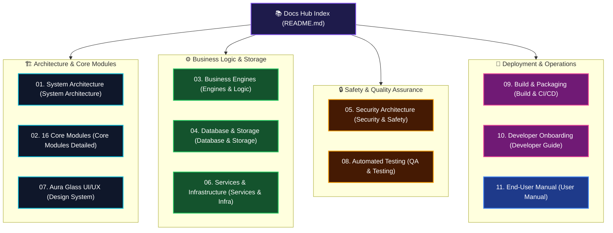

# 📚 WinCare Pro Suite — Documentation Hub

> **System Version:** v5.0.0 (Codename: Polaris)  
> **Target Platform:** Windows 10 (Build 19041+) & Windows 11 (x64)  
> **Core Stack:** .NET 10.0 • Windows App SDK (WinUI 3) • SQLite WAL • Modular MVVM  
> **Documentation Standard:** Production-Ready Technical English & Authoritative References  

---

## 🗺️ Documentation Architecture Map

This documentation directory is partitioned into **11 specialized technical chapters** and comprehensive reference guides, covering low-level architecture, diagnostic heuristics, security hardening, installer packaging, and operational procedures:

---

## 📑 Technical Documentation Chapters

| # | Document | Scope & Focus | Target Audience |
| :---: | :--- | :--- | :--- |
| **00** | [**00. AI Symbol Index & Architecture Map**](00_AI_SYMBOL_INDEX.md) | O(1) canonical symbol map, core classes, Safe Guards, Engines, ViewModels, and Tests. | *AI Agents, Developers* |
| **01** | [**01. System Architecture**](01_SYSTEM_ARCHITECTURE.md) | 4-tier modular architecture, core principles, Dependency Injection, and data flow. | *Architects, Developers* |
| **02** | [**02. Core Modules Detailed**](02_CORE_MODULES_DETAILED.md) | Technical specifications for 16 feature modules: Dashboard, AI Assistant, Junk Cleaner, Uninstaller, Security, Turbo Game, Widget,... | *Developers, Product Owners* |
| **03** | [**03. Business Engines & Logic**](03_ENGINES_AND_BUSINESS_LOGIC.md) | Heuristic AI diagnostics, RAM booster, health scoring formulas, SFC/DISM wrappers. | *Engine Developers* |
| **04** | [**04. Database & Storage**](04_DATABASE_AND_STORAGE.md) | SQLite 3 WAL Mode, PRAGMA tuning, 6-table schema, version migrations, and data security. | *Data & Backend Devs* |
| **05** | [**05. Security & Safety Architecture**](05_SECURITY_AND_SAFETY_ARCHITECTURE.md) | SafePathGuard, SafeRegistryGuard, Service Safety Whitelist, ProcessRunner ArgumentList, CancellationToken Lifecycle. | *Security Engineers* |
| **06** | [**06. Background Services & Infrastructure**](06_SERVICES_AND_INFRASTRUCTURE.md) | Background Workers, Theme Studio, bilingual i18n translation engine, UndoManager rollback. | *Core Developers* |
| **07** | [**07. UI/UX Design System**](07_UI_UX_DESIGN_SYSTEM.md) | Fluent Design 2.0, Mica Backdrop, Acrylic, Shimmer Skeleton Loader, Composition 120 FPS Motion. | *UI/UX Designers & Devs* |
| **08** | [**08. Automated Testing & Quality Assurance**](08_TESTING_AND_QUALITY_ASSURANCE.md) | 465-test xUnit suite (Production Hardening), multithreading, stress tests, mocking, and Zero-Bug policy. | *QA & Testers* |
| **09** | [**09. Build, Deployment & CI/CD**](09_BUILD_DEPLOYMENT_AND_PACKAGING.md) | Self-Contained x64 compilation, Inno Setup 6 packaging, Auto-Update configuration, and GitHub Actions CI. | *DevOps, Release Managers* |
| **10** | [**10. Developer Onboarding Guide**](10_DEVELOPER_ONBOARDING_GUIDE.md) | Visual Studio 2022 setup, C# 13 coding standards, step-by-step new module implementation guide. | *New Developers* |
| **11** | [**11. End-User Manual**](11_USER_MANUAL_VI.md) | End-user operations handbook: PC cleanup, gaming acceleration, system restoration, FAQ. | *End Users, Support Team* |

---

## 🔍 Supplementary Technical References

- [**DEVELOPER_GUIDE.md**](DEVELOPER_GUIDE.md): Executive technical guide and architecture quick reference.
- [**SYSTEM_OVERVIEW.md**](SYSTEM_OVERVIEW.md): Comprehensive system overview and technical executive summary.

---

## ⚡ Role-Based Reading Pathways

### 👨‍💻 New Developer Pathway
1. Review [**10. Developer Onboarding Guide**](10_DEVELOPER_ONBOARDING_GUIDE.md) for environment configuration and coding invariants.
2. Review [**01. System Architecture**](01_SYSTEM_ARCHITECTURE.md) to understand MVVM boundaries and DI setup.
3. Review [**02. Core Modules Detailed**](02_CORE_MODULES_DETAILED.md) and [**03. Business Engines & Logic**](03_ENGINES_AND_BUSINESS_LOGIC.md) before writing module logic.

### 🛡️ Security & Systems Engineer Pathway
1. Review [**05. Security & Safety Architecture**](05_SECURITY_AND_SAFETY_ARCHITECTURE.md).
2. Review [**04. Database & Storage**](04_DATABASE_AND_STORAGE.md).
3. Review [**08. Automated Testing & Quality Assurance**](08_TESTING_AND_QUALITY_ASSURANCE.md).

### 🎨 Frontend & UI/UX Pathway
1. Review [**07. UI/UX Design System**](07_UI_UX_DESIGN_SYSTEM.md).
2. Review [**02. Core Modules Detailed**](02_CORE_MODULES_DETAILED.md).
3. Review [**06. Background Services & Infrastructure**](06_SERVICES_AND_INFRASTRUCTURE.md) (Theme Studio & Animation).

---

  Maintained by the <b>WinCare Pro Suite</b> Engineering Team

